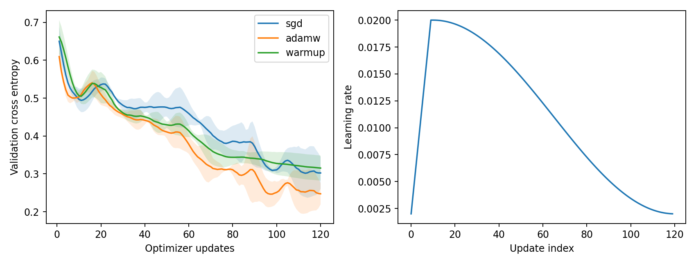
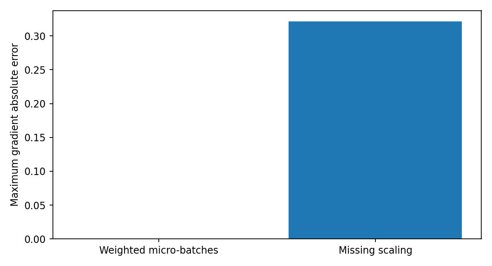

# 第088讲 深度网络的优化实践

本讲问题：优化器、batch和训练预算怎样共同决定训练过程？“换Adam后准确率更高”并不是充分的实验结论。我们还要问：两组看过多少样本，更新了几次，学习率在哪个时钟上变化，模型恢复时有没有丢掉历史。本讲把这些容易散落在训练脚本中的细节连成一个可以检验的协议。

直接先修：034至036、039、053、086至087。需要理解梯度下降、动量、自适应优化、反向传播和初始化。实验在CPU单线程上运行，使用本地生成的非线性二分类数据，不下载数据，也不调用付费服务。

## 1 从“同样训练十轮”这个误会开始

小林把batch从32改成128，说训练轮数仍为10，因此预算相同。假设训练集有1280条记录且不丢最后一批：batch32每轮40次更新，十轮400次；batch128每轮10次更新，十轮100次。两者见过的样本数都是12800，却进行了不同次数的参数调整。若衰减计划按更新步写，实际学习率轨迹也可能完全不同。

这不说明某种预算口径错误，而说明必须先确定问题。研究“每看一次数据，哪种方法学得更多”应匹配样本曝光；研究“给定更新时间，哪种配置更好”可匹配墙钟时间；研究优化算法本身可匹配更新次数和batch，另报实际耗时。三个问题的答案可以不同。

本讲主比较固定数据、初始化种子集合、120次更新、每次64个样本，总计7680次样本曝光。它不是固定墙钟竞赛，不足以评价所有优化器的效率。数据重复抽取，因此7680不是不同样本的数量。训练集只有384条，验证集128条，模型为6→32→2的Tanh网络。

## 2 把训练循环写成一个状态机

一次完整更新的顺序是：取得当前批，清空上一更新的梯度，前向计算，计算标量损失，反向累计梯度，可选裁剪，优化器更新，推进学习率时钟，记录状态。这里“反向传播”与“更新权重”不是一件事。backward把导数加到grad缓冲区，step才让优化器修改参数。

设参数为$\theta_t$，当前批平均损失为$L_t$。最简单的SGD是

$$g_t=\nabla_\theta L_t(\theta_t),\qquad \theta_{t+1}=\theta_t-\eta_tg_t.$$

$\eta_t$是第$t$次更新使用的学习率，而不是一个永久不变的模型属性。同一个参数值配上不同的优化器历史，下一步可能不同。比如动量缓冲$v_t$保留过去方向：

$$v_t=\mu v_{t-1}+g_t,\qquad\theta_{t+1}=\theta_t-\eta_tv_t.$$

若只保存$\theta_t$，恢复后把$v_t$清零，相当于让一辆正在转弯的车瞬间丢掉已有速度。这仍能继续训练，但不是原轨迹的延续。

Adam类方法维护一阶与二阶移动平均，二阶量近似衡量各坐标梯度尺度。偏差修正还依赖步数。于是权重、动量、平方梯度累计和step计数共同决定下一次更新。不要把“文件能加载”当成“续训正确”。

## 3 预热为什么可能有用，为什么不应神化

初始化后，激活尺度、梯度尺度以及自适应优化器的统计量可能尚未稳定。如果一开始使用较大的步长，最早几次更新就可能把参数推到很差的区域。线性预热让前$T_w$次更新的步长逐渐达到峰值：

$$\eta_t=\eta_{\max}\frac{t+1}{T_w},\qquad 0\le t<T_w.$$

这里$t$从0开始，所以第一步不是零。若$\eta_{\max}=0.02,T_w=10$，前四步是0.002、0.004、0.006、0.008。代码必须说明从0还是1计数，否则“预热10步”很容易变成9步或11步。

预热不是梯度传播故障的通用修理工具。如果第087讲已经发现深层梯度被饱和激活压到几乎为零，预热并不会恢复信息；若标签错位或loss输入错误，平滑学习率只是平滑地训练错误任务。先证明训练链路有效，再调预热。

## 4 衰减是把探索和收敛放在不同时段

余弦衰减的一种写法是

$$\eta_t=\eta_{\min}+\frac{\eta_{\max}-\eta_{\min}}{2}\left[1+\cos\left(\pi\frac{t-T_w}{T-T_w}\right)\right].$$

当$t=T_w$时处在峰值附近，随着$t$增长缓慢下降。实际循环使用$t=0,\ldots,T-1$，最后一步通常略高于$\eta_{\min}$；这不是错误，只是端点约定。若希望最后一次更新恰好用最小值，需要修改分母或计数方式，并写进协议。

为什么不从头就用最小学习率？小步长可能减少振荡，却需要更多更新才能走过相同距离；有限预算下可能还没到达较好区域就结束。为什么不一直用最大值？后期可能围绕较窄区域来回波动。学习率计划是对优化过程的假设，最终要用损失轨迹验证，不能只看名字。

若使用框架scheduler，要弄清step在optimizer.step前还是后调用、按epoch还是按update调用。梯度累积时，每个micro-batch推进scheduler会让时间快进；恢复训练时重新从预热开始又会让时间倒退。本实验用显式rate(t)函数，把时钟写在代码中，减少隐藏状态。

左图阴影是三个种子的样本标准差范围，不是置信区间。右图只描述预热配置。此图用于读取变化过程，不用于宣称某优化器普遍最优。

## 5 梯度裁剪究竟改了什么

设所有参数梯度拼成一个向量$g$，总二范数为$\|g\|_2$。全局范数裁剪阈值为$c$时，使用

$$\tilde g=g\min\left(1,\frac{c}{\|g\|_2+\epsilon}\right).$$

若范数不超过$c$，方向和大小都保持不变；若超过$c$，所有分量按相同比例缩放，因此保持整体方向。逐元素裁剪则会分别截断坐标，通常改变方向。两者不能混写成同一种操作。

数值例：梯度$(3,4)$的范数是5，阈值为2时得到$(1.2,1.6)$。对普通SGD，参数更新的范数最多约为$\eta c$。对Adam，这个说法不能原封不动使用，因为后续还有坐标相关的缩放和动量；裁剪限制的是送入优化器的梯度，不直接保证最终参数位移的同一上界。

裁剪是一道保护措施，不是忽略异常的许可证。应记录裁剪前范数、触发比例和是否出现非有限值。NaN不是“一个很大的数”，裁剪不能可靠地把NaN变回有效梯度。若每一步都严重裁剪，应检查输入量纲、损失缩放、初始化和学习率。

## 6 梯度累积：先从平均数推导

显存或内存限制可能不允许一次处理大batch。于是把一组样本分成若干micro-batch，分别前向和反向，但只更新一次参数。若总样本数为$N$，第$j$个微批有$n_j$个样本，微批平均损失为$L_j$，整体平均损失应为

$$L=\frac{1}{N}\sum_{i=1}^N\ell_i=\sum_j\frac{n_j}{N}L_j.$$

由求导的线性性，整体梯度就是各微批梯度的相同加权和。等长$K$个微批可以把每个平均loss除以$K$；不等长时必须按$n_j/N$加权。直接把所有平均loss各反传一次而不缩放，会改变更新尺度。若最后一个微批很短，简单除以$K$也不是正确的样本平均。

本讲故意采用16、16、5三段，共37条。正确权重是16/37、16/37、5/37，而不是三个1/3。先对37条一次反传作为参考，再对三段加权反传，逐参数检查最大绝对差。

这张图包含一个很接近零的柱子。接近零是数值核验结果，不是“没有执行”。请查results.json里的精确数值，不要仅凭柱形图判断误差是否可接受。

## 7 累积与大batch什么时候不等价

前面的推导假设每个样本损失的计算没有因分批而改变。普通线性层、逐样本激活和确定性loss满足本例条件，但BatchNorm在训练模式下使用当前微批统计量，微批输出本身已经不同；因此累积梯度并不自动恢复大batch的BatchNorm行为。

Dropout也会因随机掩码与调用顺序而产生不同数值轨迹。期望层面相似不等于逐元素一致。浮点加法顺序不同也会产生细微误差。因此我们用无BatchNorm、无dropout的网络进行累积恒等式核验，把机制隔离出来，而不是给所有网络许诺逐位相同。

正确循环应在累积组开始时zero_grad，在每段执行加权loss.backward，在组结束时裁剪并step。若每段都zero_grad，只剩最后一段梯度；若每段都step，就不再是同一参数点的梯度和；若每段都clip，所得总和一般也不等于先求和再clip。

## 8 checkpoint是一份“足以继续”的状态快照

本实验在第57次更新完成后暂停，保存model state_dict、optimizer state_dict、下一步编号、CPU随机数状态和历史记录。数据索引由独立种子提前生成，因此从step定位下一批即可。磁盘上真实写入checkpoint.pt，然后用torch.load重新读取，进行后续63次更新。

一般训练还可能需要保存scheduler、混合精度缩放器、数据采样器/游标、NumPy与Python随机状态、数据版本和配置。分布式训练还涉及各进程状态。若在梯度累积中途保存，还要保存尚未更新的梯度缓冲与累积进度，或者明确只允许在更新边界保存。少保存一种真正影响未来计算的状态，就不能严格宣称连续性。

本讲不需要混合精度和多进程，故未伪装成覆盖这些复杂场景。CPU单线程和确定性算法降低了验证复杂度，跨软件版本、硬件或算子实现仍不保证位级复现。加载来源不明的模型文件有安全风险；本课只加载自己刚写出的可信文件，并显式使用weights_only=True。

## 9 两个恢复试验，而不是一次“加载成功”截图

第一组从头训练120步，第二组训练57步、完整保存、恢复到120步。比较所有参数的最大绝对差。第三组故意只恢复模型权重，不恢复AdamW历史；它从同一个step继续用同一学习率和同一批索引，用来隔离“丢失优化器状态”的后果。

完整恢复本例应达到零差异或预定数值容差。仅恢复权重通常会得到非零差异，即使最终准确率相似。准确率是离散且粗糙的读数；两个参数状态可能落在同一分类区域，却已不再是同一训练轨迹。验收必须看参数或预测的细粒度差异。

## 10 如何阅读本次真实输出

outputs/results.json保存每个种子、每一步的验证loss、训练批loss、实际学习率和裁剪前范数，以及时间、环境与协议。训练loss来自当前随机批，验证loss来自固定128条记录，二者不是同一个估计量；不能把批loss的一次上升自动解释成退化。

选择配置时，本例的验证集可用于比较和诊断，但没有另设最终测试集，故这里只报告“验证表现”。不要把它改名为测试分数。若需要正式比较泛化，下一步应预先固定选择规则并保留未参与选择的测试集，而不是继续盯着同一128条记录反复调参。

三种子比单种子更能暴露随机性，却远不足以证明细小差异稳定。优先关注机制性事实：正确累积是否匹配参考梯度、完整恢复是否连续、遗漏状态是否改变轨迹。这些配对检查比“某条曲线稍低”更适合作为本讲结论。

## 11 故障排查表：先找时钟，再找尺度

|现象|优先检查|最小验证|
|---|---|---|
|累积后loss突然爆炸|mean loss是否按样本数缩放|比较一次大batch与微批梯度|
|恢复后loss折线突然换方向|优化器、scheduler和批游标|完整恢复与不中断逐步比对|
|学习率过早变小|每个micro-batch都推进时钟|打印前20次真正step的lr|
|batch增大后训练变差|更新次数是否同步减少|同时记录曝光量与更新量|
|裁剪每次都触发|输入尺度、异常梯度、阈值|画裁剪前范数而非只看裁剪后|

不要一次改五个开关。先复现，再选一个解释，做一组能推翻解释的对照。实验结束后把“不知道的部分”写清楚，通常比给出一个没有条件的最优参数更有科研价值。

## 12 本讲练习与迁移任务

1. 1280条数据、batch32与128，各训练10轮，分别算更新数与曝光量。
2. 微批长度为8、8、3，写出三段平均loss的正确权重，并解释为什么不是1/3。
3. 梯度为(6,8)、阈值5，手算裁剪结果。这个阈值能否直接界定Adam参数更新范数？
4. 把恢复实验改成只丢scheduler状态，设计可以隔离这一错误的对照。
5. 把网络加入BatchNorm，再比较大batch和累积梯度，预测为何不再匹配。
6. 为一台只能运行30分钟的CPU机器设计公平的优化器比较，说明为什么本讲的固定更新预算不能直接替代你的方案。

详细操作在lab.md，逐题推理和边界在answers.md。完成本讲的标准不是背出“保存optimizer”，而是能用一个失败对照证明：你确实知道哪一份状态决定了后续训练。

## 本次运行留下的具体证据

本包实测：正确加权累积的最大梯度差为2.98×10^-8，漏缩放时为0.3215；完整checkpoint恢复与不中断训练的最终参数差为0，仅恢复权重时为0.1132。前一对结果验证样本平均的代数关系，后一对验证优化器历史的重要性。这些数值不是通过筛选最好种子得到，恢复对照固定使用种子11。

## 参考与实现依据

- PyTorch官方优化器文档：https://docs.pytorch.org/docs/2.14/generated/torch.optim.AdamW.html 。用于核对AdamW状态与解耦衰减语义；本讲推导和数据均为原创教学内容。
- PyTorch官方序列化说明：https://docs.pytorch.org/docs/2.14/notes/serialization.html 。用于核对state_dict和可信文件加载。访问核验日期：2026-10-19。
