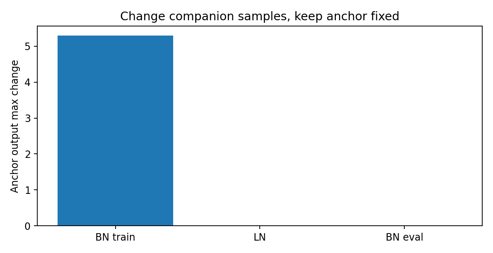
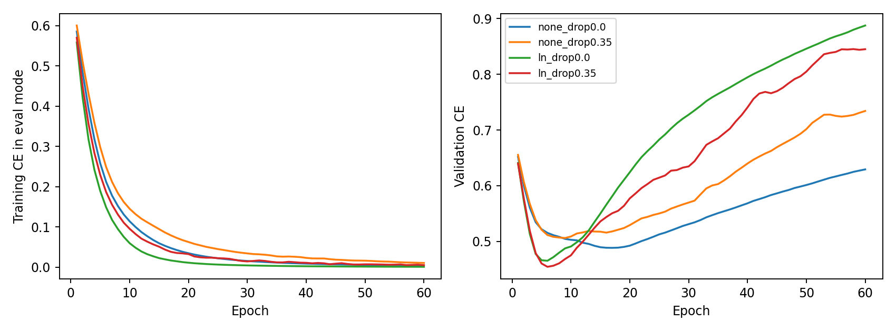
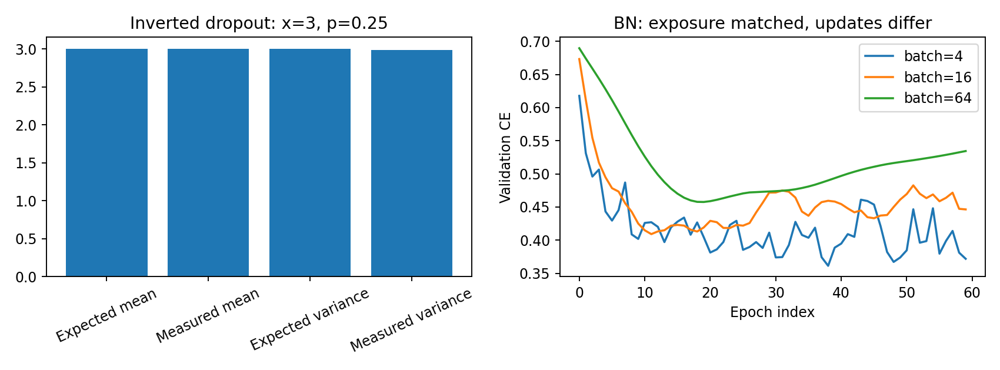

# 第089讲 归一化与正则化

本讲问题：稳定训练和限制拟合分别解决什么问题？把BatchNorm、LayerNorm、dropout、weight decay全部加进一个网络，然后说“加了正则化所以变好”，会掩盖它们不同的工作位置、状态和统计假设。本讲先拆开每个机制，再用控制变量实验观察它们的组合。

直接先修：021、040、048、083、086至088。需要均值方差、经验风险、训练/验证划分和优化器状态。实验使用CPU本地合成数据，训练64条、验证256条，故意让过拟合有机会出现。数据不是现实基准，不能用结果给所有任务推荐默认配置。

## 1 两个失败故事对应两类问题

故事一：网络一开始就输出极大数，梯度快速振荡，训练loss降不下来。此时重点是可优化性、尺度和数值稳定性。故事二：训练loss不断下降，验证loss先降后升；网络能拟合见过的记录，却在新记录上出错。此时重点是泛化和模型选择。

归一化通常重新表达中间激活，可能让优化更方便；正则化通常通过约束、随机性或停止规则限制拟合。二者存在交叉：BatchNorm的批统计随机性可能产生正则效果，dropout也会改变梯度噪声。但这种交叉不意味着概念可以互换。面对故事一，不能直接把dropout加大；面对故事二，也不能保证换LayerNorm就解决泛化。

最有效的提问是：这个操作改变了哪一个数学对象？是输入、激活、损失、参数更新，还是选择训练终点的规则？它在训练与推理时是否相同？它需要保存哪些状态？

## 2 一个统一的归一化公式，许多不同的轴

对选定的一组数$x_1,\ldots,x_m$，先算

$$\mu=\frac1m\sum_i x_i,\qquad v=\frac1m\sum_i(x_i-\mu)^2,$$

再做

$$\hat x_i=\frac{x_i-\mu}{\sqrt{v+\epsilon}},\qquad y_i=\gamma_i\hat x_i+\beta_i.$$

$\epsilon$防止分母过小；$\gamma,\beta$是可学习仿射参数，让网络能恢复适合任务的尺度和偏移。没有仿射变换时，标准化可能无意删除有用的绝对尺度；有了仿射变换，也不代表所有被删除的信息必然可恢复，因为逐样本均值等内容可能已经不再存在。

真正决定方法性质的是“哪一组数一起算均值方差”。同一个公式沿不同轴计算，会得到不同含义。先画张量形状，再画统计轴，是理解归一化的最短路径。

## 3 BatchNorm：同一特征向不同样本借统计量

考虑表格/全连接激活$X\in\mathbb R^{B\times D}$。BatchNorm对每个特征$d$，跨批中$B$个样本计算均值与方差：

$$\mu_d=\frac1B\sum_{b=1}^B X_{bd},\qquad v_d=\frac1B\sum_b(X_{bd}-\mu_d)^2.$$

因此一个样本的输出会受同批其他样本影响。对卷积特征$(B,C,H,W)$，常见BatchNorm2d沿$B,H,W$汇总，每个通道一个统计量；它不是只把同一张图的空间位置单独标准化。

手算例：同一特征在三个样本上为1、2、3，均值2、方差2/3，忽略epsilon后第一个样本输出约-1.225。把第三个样本改为9，均值变为4、方差38/3，第一个样本仍为1，归一化输出却变为约-0.843。这种同伴依赖是定义的后果，不是代码偶发bug。

小batch统计会更不稳定；样本高度相关时，有效独立信息比batch大小看起来更少。比如一批全来自同一个病人或同一段视频，增加帧数不等于增加相同数量的独立样本。BN的效果必须结合采样机制讨论。

## 4 为什么BatchNorm要区分train与eval

常见实现训练时使用当前批统计，并更新running_mean与running_var；推理时使用存下来的运行统计，以避免预测随同伴变化。运行平均的一般形式为

$$r_{t+1}=(1-\alpha)r_t+\alpha s_t.$$

这里$\alpha$表示给新统计量的权重，不要和优化器的momentum符号机械对应。在PyTorch BatchNorm中，训练前向的方差使用有偏估计，而运行方差更新涉及无偏估计；两者不是同一个数值对象。做逐元素框架核验时要按官方定义处理。

调用eval不会关闭自动求导；no_grad也不会自动把BN切到推理模式。它们分别控制模块行为和梯度记录。正确验证通常是model.eval配合no_grad；验证后继续训练要再model.train。将两种开关混为一谈，是最常见的训练/推理错误之一。

运行统计是模型状态的一部分，需要跟权重一起保存。若部署输入分布和训练分布不同，固定运行统计可能不再合适；但直接拿测试数据重新更新统计也是一种适应步骤，必须在评估协议中申明，不能悄悄把它当普通推理。

## 5 LayerNorm：在一个样本内部比较特征

对同样的$(B,D)$矩阵，LayerNorm通常对每个样本$b$，在其$D$个特征内计算统计：

$$\mu_b=\frac1D\sum_dX_{bd},\qquad v_b=\frac1D\sum_d(X_{bd}-\mu_b)^2.$$

因此同一条记录换一批同伴，结果不变。它通常在训练和推理都用当前样本自身的统计，不维护BN式运行均值。对于序列$(B,T,D)$，常见LayerNorm(D)归一化最后一个维度，并不默认把整条序列所有token一起归一化。

若把输入整体加常数$c$，均值也加$c$，相减后抵消；忽略epsilon时，统一正比例缩放也会被抵消。这个性质在某些表示里有益，在绝对强度本身就是标签信息的任务中却可能不适合。因此“对batch不敏感”并不是“任何任务都比BN好”。

图中BN train使用当前批统计；LN按样本归一化；BN eval使用同一份冻结运行统计。该探针隔离了统计轴与状态，远比只比较最终准确率更直接。注意本图BN train的专用对象关闭running stats，是为了只观察当前批效应；常规训练网络仍开启运行统计。

## 6 Dropout：随机删除后为什么还要除以保留概率

设drop概率为$p$，保留概率为$q=1-p$，随机变量$m\sim\mathrm{Bernoulli}(q)$。反向缩放dropout在训练时使用

$$\tilde h=\frac{m}{q}h.$$

给定激活$h$，有$E[m]=q$，于是$E[\tilde h\mid h]=h$。推理时直接用$h$即可，不需要再乘$q$。若误把训练和推理都缩放一次，激活尺度会偏小。

期望保持不等于输出稳定。因为$m^2=m$，

$$\mathrm{Var}(\tilde h\mid h)=h^2\frac{p}{1-p}.$$

本实验取$h=3,p=0.25$，保留时输出4，删除时输出0，理论均值3，方差3。我们采样20万个值检验样本均值和方差。这是统计验收，不能要求每次恰好等于理论值；应设合理容差并固定随机种子。

还要注意$E[f(\tilde h)]$一般不等于$f(E[\tilde h])$。非线性下，推理网络不是所有dropout子网络输出的精确平均。dropout的直觉可以帮助理解，但不能替代数学边界。

## 7 Dropout到底在限制哪种拟合

训练时部分激活随机不可用，使某些过于依赖固定特征组合的路径不稳定，促使网络分散信息。它同时增加优化噪声，过高比例可能使小网络欠拟合；“训练分数降低”本身不证明泛化提高。

本讲控制dropout为0或0.35，保持其他设置。记录训练loss时统一切到eval，因此看到的是不加随机掩码的训练集表现；若用train模式测训练loss，会混入dropout随机性，不能直接和eval验证loss作同口径比较。论文和实验日志中应说明记录模式。

dropout对每个坐标、通道还是路径操作也不同。本讲用最普通逐元素Dropout，不把结果推广到空间dropout、stochastic depth或注意力dropout。术语相似不等于干预相同。

## 8 L2惩罚与解耦weight decay的分界

若优化目标加入$\lambda\|\theta\|_2^2/2$，梯度变为$g+\lambda\theta$。对普通SGD，

$$\theta_{t+1}=\theta_t-\eta(g_t+\lambda\theta_t)=(1-\eta\lambda)\theta_t-\eta g_t.$$

因此在这个设定下，它等价于每步乘一个收缩因子再做梯度更新。可是自适应优化器会对梯度做坐标相关缩放，把$\lambda\theta$也塞进梯度处理时，实际收缩不再是统一的乘法。AdamW把衰减与梯度自适应部分解耦，避免把这两件事混在一起。

本讲使用AdamW的weight_decay=0.01。它并非正则强度的普遍推荐值，只是保持配置固定的教学选择。是否对偏置和归一化参数衰减，也是可单独研究的设计。本例对所有参数统一衰减，避免暗藏分组规则；正式任务需明确写出分组。

相同weight_decay配不同学习率计划，累计收缩也不同。若忽略损失梯度，只看乘法衰减，$T$步后系数约为$\prod_t(1-\eta_t\lambda)$。因此比较正则化不能脱离训练步数与学习率。这与第088讲的预算时钟直接相连。

## 9 Early stopping是一条模型选择规则

训练越久不一定验证越好。early stopping先约定监控指标、最小改善阈值、patience和最大训练预算，再根据验证指标停止或选择checkpoint。若最后只停止却没有恢复最佳权重，得到的是“停止时模型”，不一定是“验证最优模型”。

在本实验中，我们完整跑60轮并记录验证loss最小的轮数，用于教学观察，没有宣称实现在线早停，也没有用该模型做独立测试。它帮助你看清“训练终点”和“最佳验证时刻”是两件事。lab要求你扩展真正的patience逻辑，并保存最佳state_dict。

绝不能看着测试分数决定何时停止。测试集一旦被反复用来挑epoch，就参与了选择，已经不再提供相同意义的独立评估。验证集也会因大量调参被过度使用，正式报告应保留最终独立评估或采用嵌套划分。

## 10 数据增强：先审标签保持，再讨论正则

数据增强把一条训练样本变成多个合理视图，隐含“这些变化不改变任务答案”的先验。对日常物体照片，小幅平移可能合理；对数字6与9，随意旋转180度就可能改变标签；对医疗影像，左右翻转还可能改变解剖语义。

因此增强不是免费制造数据。先定义允许变换，再检查标签保持条件，最后只对训练集在线应用。验证/测试变换应预先固定并与部署场景一致。若使用测试时增强，必须计入额外推理预算，并明确聚合方式。

本讲合成表格任务没有默认启用增强，因为特征乘积和阈值定义了标签，随意加噪不保证标签保持。为了看起来“全面”而加一项未经论证的增强，反而会破坏控制变量。练习中需要学生设计小范围变换并分析安全边界。

## 11 一个2×2实验怎样防止故事讲反

主实验有四种设置：无归一化无dropout、仅LayerNorm、仅dropout、LayerNorm加dropout。每种用11、23、37三个种子；数据划分、60轮、batch16、学习率和weight decay保持一致。四组组成一个简单因子设计，可以观察某个机制在另一个机制开启时是否改变效果。

归一化增加了仿射参数，因此四组参数量不完全相同。这不是严格参数量匹配的结构竞赛，而是实际模块干预实验。若要把收益归因于“归一化统计”本身，还应增加去仿射或参数匹配的对照。

单独的BN batch探针使用4、16、64三种batch，保持60轮和样本曝光一致。每轮更新分别是16、4、1次，所以它同时改变了更新次数，不能据此把所有变化都归因于BN统计。它的用途是提醒你实际训练配置如何耦合，并为进一步匹配更新预算的实验提出问题。

读图时先读坐标、口径和对照，再看哪条线更低。该小任务上的最优组合可能不稳定；本讲最强证据来自统计轴探针和dropout矩检验，因为它们直接检验定义。

## 12 常见错误及其最小反例

- 把BN和LN当可互换：固定样本、改变同伴，观察输出是否变动。
- 验证忘记eval：同一验证样本和不同同伴拼批，预测可能改变，BN统计还被污染。
- 认为eval关闭梯度：在eval模式仍可对输入求梯度，证明二者独立。
- 推理时继续dropout：重复预测同一数据会随机变化，除非你明确做随机推理研究。
- 将Adam上的L2和AdamW混称：写出每个坐标的自适应缩放位置即可发现不同。
- 用测试集选epoch：这是评估协议错误，不会靠增加种子自动消失。

## 13 完成本讲的练习

1. 手算矩阵[[1,2],[3,6]]的BN列统计和LN行统计，暂设epsilon为0、无仿射。
2. 推导dropout方差，并计算$p=0.5,h=2$时的可能输出、均值与方差。
3. 设计一个不训练网络就能区分BN和LN的实验。
4. 解释为什么相同epoch下比较BN的batch4与batch64不是只改变一个因素。
5. 写出early stopping的patience=5流程，并说明最终测试集什么时候才能使用。
6. 判断“对所有图像做左右翻转”是否总是标签保持，给两个反例。

## 本次运行留下的具体证据

本包实测：改变同伴后BN train锚点最大差为5.2915，LN与冻结BN eval均为0；输入统一加10时冻结BN平均差为9.4831，LN差为0。Dropout样本均值3.00498、方差2.99002，均接近理论值3。主训练四组并未表现出“加模块一定更好”：例如LN无dropout的最终验证loss在三个种子为0.8854、0.8674、0.9097。这个负面观察应保留，不能为了配合理论删掉。

## 参考与实现依据

- BatchNorm1d官方定义与运行统计约定：https://docs.pytorch.org/docs/2.14/generated/torch.nn.BatchNorm1d.html
- LayerNorm官方归一化轴与仿射说明：https://docs.pytorch.org/docs/2.14/generated/torch.nn.LayerNorm.html
- AdamW官方实现语义：https://docs.pytorch.org/docs/2.14/generated/torch.optim.AdamW.html

访问核验日期：2026-10-19。数学例子、探针、数据和图均为本课程原创教学设计。
