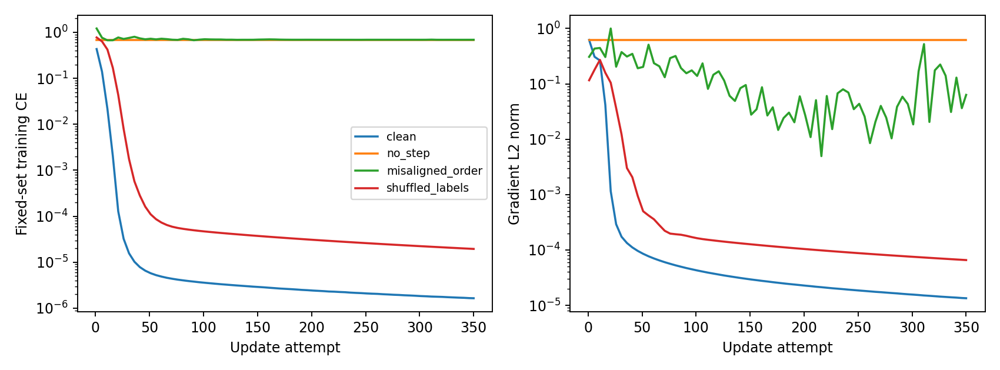
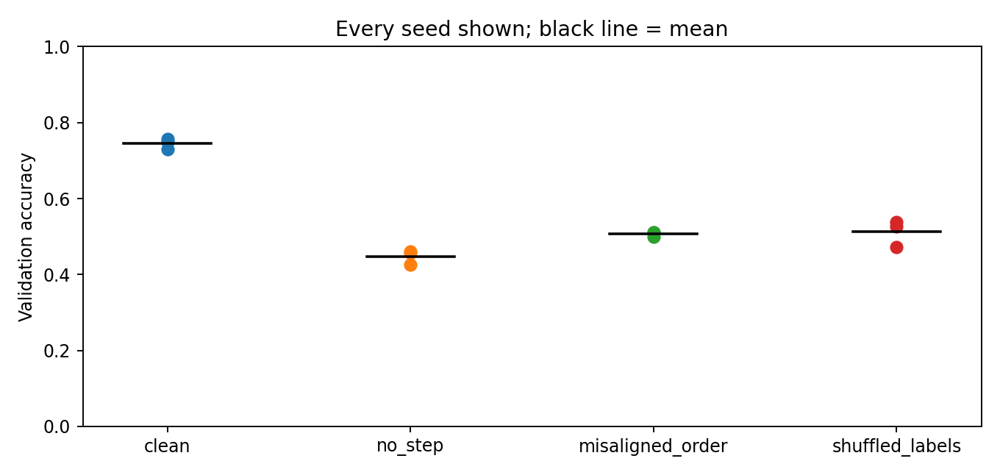
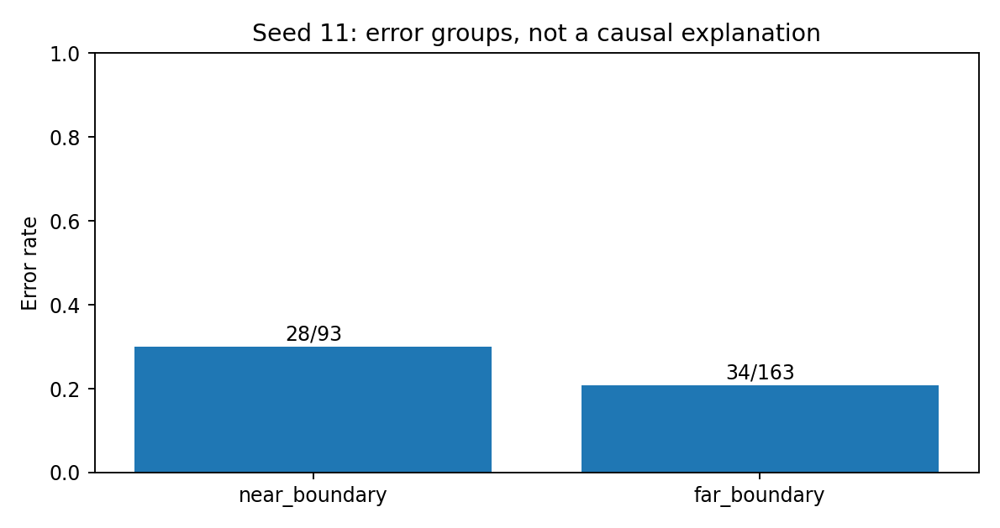

# 第090讲 神经实验的诊断顺序

本讲问题：如何避免一次昂贵训练掩盖一个简单实现错误？一个能完成几千轮训练、输出漂亮曲线的脚本，仍可能在学习错位标签，或者根本没有更新参数。诊断的目标不是把每一种技巧都试一遍，而是按成本从低到高排除解释，让每一次运行都缩小问题范围。

直接先修：007、025至026、046、050至051、053、086、088至089。先会数据划分、指标、反向传播、优化状态和train/eval。本讲只训练一个很小的全连接网络，在24个训练样本上做机制诊断，用独立生成的256条记录观察泛化差异。

## 1 把“模型不好”拆成四种可检验命题

训练表现不好可能是数据链路错、损失或反向实现错、优化配置不合适，也可能是模型能力不够。验证表现不好还可能是过拟合、分布偏移或评价错误。若不区分这些命题，调大网络、延长训练和更换优化器都会成为没有方向的尝试。

例如训练loss始终不动，可能是学习率太小，也可能是忘了optimizer.step。两者在最终分数上都表现为差，但参数位移检查可以立即区分。又例如训练准确率100%、验证接近随机，可能是过拟合，也可能是标签本来就被随机置乱；检查标签来源比增加dropout更有价值。

因此本讲采用“先检查不需要训练的事实，再检查一次更新，再检查少样本拟合，最后检查泛化”的顺序。每一步都写下输入、预期、证据和失败后的下一步。诊断是一次有分支的推理过程，不是一张打勾就万事大吉的表。

## 2 第一层：不训练，先核对数据链路

先打印几条带稳定样本ID的原始记录、处理后特征和标签。确认样本轴、特征轴、dtype、数值范围和缺失值。分类标签应在合法类别范围内；类别数是2并不意味着标签可以任意使用1和2，因为某些交叉熵接口期待0和1。

再检查划分：训练、验证、测试是否按需要互斥，重复记录是否跨集合，时间序列是否使用未来信息。标准化的均值方差是否只由训练数据估计？标签映射在不同文件里是否一致？同一名称排序规则不同，也会导致“类别0”在两个地方代表不同对象。

最后建立数据配对不变量。给每条样本附上ID，所有shuffle、过滤、合并和batch操作都让特征ID与标签ID保持一致。只检查特征形状和标签分布是不够的：错位后它们往往完全正常。

本实验用一个故意错误的操作展示问题：每一步只打乱X，却不打乱y。这使相同输入在不同步对应不同目标。更隐蔽的是只错位一次并固定下来，那会形成一个可被大网络记住的错误映射；少样本过拟合也未必能发现它。因此ID审计不能被训练测试取代。

## 3 第二层：一次前向，先看损失的量纲

随机初始化二分类网络输出接近均匀概率时，平均交叉熵通常在$\log 2\approx0.693$附近。三分类的相应参考是$\log 3$。这只是检查量级的直觉，不是必须精确达到的常数：初始化偏置、样本分布与输出尺度都会造成偏离。

交叉熵的定义为

$$L=-\frac1N\sum_{i=1}^N\log p_{i,y_i}.$$

若把原始logits送入一个内部已经实现log-softmax的loss，这是正确方式；若先softmax再当logits输入，可能改变数值尺度和梯度。不要只凭函数名字猜输入语义，要核对接口及一个手算样本。

手算例：真实类别为1，预测概率为(0.2,0.8)，loss是$-\log0.8\approx0.2231$；预测为(0.9,0.1)，loss是$-\log0.1\approx2.3026$。若错误预测反而得到更小的损失，先修评价或标签，不要继续训练。

## 4 第三层：一次反向，分开看梯度与参数位移

一次反向后检查：每个应训练参数是否有grad，grad是否有限，范数是否异常；一次step后检查参数是否真的变了。梯度存在不代表更新发生，参数变化也不代表更新方向正确。

定义全局梯度范数

$$G=\sqrt{\sum_k\|\nabla_{\theta_k}L\|_2^2},$$

相对参数位移可写为

$$R=\frac{\|\theta_{t+1}-\theta_t\|_2}{\|\theta_t\|_2+\epsilon}.$$

$G$观察反向信号，$R$观察优化器实际动作。不同模型和参数尺度下没有统一“正常阈值”；应结合初始基线和层级分布阅读。一个小偏置向量和大权重矩阵的范数也不能直接横比。

本讲故意构造no_step模式：正常前向、loss.backward、记录梯度，但不调用step。结果会出现非零梯度、零参数位移、固定训练损失。这种证据比“再把学习率翻倍试试”强得多，因为它直接命中了训练循环缺失的动作。

## 5 为什么要检查激活，而不只检查梯度

梯度异常可能从前向就开始。记录每层激活均值、标准差、分位数、最大绝对值和非有限比例，可以定位尺度在哪一层发生变化。ReLU可看零值比例，Tanh/Sigmoid可看接近饱和区的比例。单独一个“零值很多”不必然是故障，需要结合输入、层数和任务。

本实验网络使用Tanh，把绝对激活大于0.99的比例作为一个简单饱和探针。它不是普遍诊断标准，只是把一个可观察现象写入结果。若比例随训练上升，但loss仍正常下降，就不能自动宣布网络坏了；应继续看反向梯度和参数更新。

逐层记录还可帮助区分：前几层没有梯度是因后面detach，还是激活饱和，还是这些参数没有放进optimizer？一个最终全局范数可能被最后一层的大梯度遮盖，所以正式项目应保留逐层信息。

## 6 第四层：把24条数据真正记住

先选一小批固定样本，关闭dropout与随机增强，使用足够容量，训练到很低loss。这是在问“这条训练链路是否能优化一个容易的有限目标”，并不是在评价泛化。

本实验使用5→64→64→2网络，Tanh激活，Adam学习率0.02，全批350次更新。训练24条记录。干净标签来自非线性规则：第0、1特征乘积，加0.8倍第2特征，减0.3倍第3特征，分数大于0记为1。规则只是制造可控任务，不是现实领域知识。

若小样本不能拟合，先查数据、标签、损失、梯度、更新，再查容量和优化配置。不要立即把结论写成“任务太难”。如果小样本能拟合，也不能直接宣布所有代码正确：固定的错误标签也可以被记住，损失实现中的某些错误也可能被高容量模型掩盖。

## 7 标签置乱是负对照，解释要特别谨慎

我们只把训练标签随机置乱一次，保持该错误映射固定，验证标签仍由原规则生成。足够灵活的网络可以把这些随机标签记住，因此训练loss很低并不令人意外；验证表现则不能再依赖训练标签中原有的规律。

不要把标签置乱说成“训练准确率必须接近随机”。这个命题只在容量、预算等特定条件下可能出现。对于能记忆小数据的网络，恰恰应该预期高训练准确率。置乱对照回答的是：模型有没有只是记忆，以及评价流程是否可能泄漏。

如果标签置乱后独立验证仍异常优秀，需要检查置乱是否实际执行、验证标签是否也被错误处理、重复样本或目标信息是否泄漏。但一次看起来偏高的分数不构成泄漏的证明；小验证集和随机性也可能产生波动，需要进一步实验。

## 8 一个正常对照与三种失败模式

|模式|被改变的机制|预期诊断特征|
|---|---|---|
|clean|无故意错误|固定小样本loss可降至很低|
|no_step|反向后不更新参数|梯度存在，参数位移为零，loss不变|
|misaligned_order|每步只打乱输入|目标关系不断变化，固定样本难拟合|
|shuffled_labels|固定随机训练标签|可能完美记忆，但泛化与干净训练不同|

图里loss在固定训练输入上计算，misaligned_order实际更新用的批在该步已错位，所以它的更新目标与图中固定映射评价不是同一个量。这个口径刻意保留：我们要观察一个被不断扰乱的训练循环能否学会稳定映射，而不是把变化的批目标误称为固定任务loss。

## 9 数据顺序：合法打乱与错位不是一回事

合法打乱是使用同一排列$\pi$，形成$(x_{\pi(i)},y_{\pi(i)})$。错位打乱是$(x_{\pi(i)},y_i)$。前者保留样本配对，后者改变任务。两种操作的张量形状和标签直方图完全一样，靠这些浅层检查无法区分。

还有一种更细的顺序效应：数据配对正确，但按类别顺序送入小批，可能让梯度和BN统计产生强相关。此时它不是实现错误，而是采样策略的选择；应比较顺序采样和随机采样，并控制预算与随机种子。不要把所有“顺序影响”混成标签错位。

全批确定性梯度在数学上不受样本排列影响，但浮点求和顺序可能带来细微数值差异。含BN等批依赖操作时，即使配对正确，如何分批也会改变计算。这些边界与第088、089讲相互呼应。

## 10 多种子：把实验单位说清楚

本讲每种模式运行11、23、37三个初始化种子，数据生成和划分保持固定。于是这些种子反映初始化及训练随机性的变化，不反映不同数据集抽样的不确定性。若要估计数据抽样的不确定性，需要另做数据划分或重采样，不能把两种变异混用。

报告均值、标准差和每个种子，比只给最好分数更诚实。同一种子用于比较两种模式时，差值是配对的；应优先分析每个种子的差值，而不是把两边当完全独立样本。只有三个种子，区间估计非常不稳定，不宜据此给细小差异下强结论。

如果运行十个种子，只发表最好的一个，相当于做了选择却隐藏了选择过程。最好种子可以作为示例可视化，但主结论要来自预先说明的聚合规则。失败运行也应保留并解释，不能默默删除。

## 11 误差分类：从总分走向下一次实验

验证准确率只给一个平均结果。我们按生成分数绝对值是否小于0.5，把样本分成near_boundary与far_boundary两组。前者距离决策边界更近，通常更容易受有限训练数据影响。阈值在看结果前写进代码，避免观察哪里错就临时定义哪里是“困难组”。

这个分组只是描述。靠近边界的错误更多，不证明“边界距离导致了所有错误”，也不保证现实任务能获得同样的真值margin。真实项目可以按采集设备、时间段、长度、类别或数据质量分组，但应注意隐私、样本量和多重比较。

每组必须同时给分母。2/4和20/40都是50%，证据强度不同。若某组没有样本，错误率应标为不可估计，不能填0。若某个组只有几条记录，优先检查个案和补数据，而不是凭一个百分比大改模型。

## 12 一个可直接采用的诊断决策流程

第一步，数据基本性质不通过：停止训练，修数据管道。第二步，一次前向不有限或loss量级不合理：检查预处理、logits、标签和loss接口。第三步，梯度缺失或非有限：检查计算图、detach、requires_grad和数值尺度。第四步，有梯度却无参数位移：检查optimizer参数列表、zero_grad/step顺序和学习率。

第五步，小样本不能拟合：先减少随机性，查标签配对，必要时增加一点容量或优化预算，但一次只改一个因素。第六步，小样本能拟合而验证差：再看数据覆盖、正则化、分布变化和评价协议。第七步，主结论看似成立：运行负对照、多种子和误差分组，尝试推翻自己的解释。

这个顺序不是硬性流水线。某些数据泄漏会让训练和验证都很漂亮，必须回到第一步；某些数值故障只在长训练后出现，需要保留长程监控。核心原则是“先用便宜且有辨别力的检查”，而不是永远只做小实验。

## 13 从教学脚本迁移到科研项目

将每次实验记录为：假设、唯一主要改动、固定项、随机种子、数据版本、预算、指标、预期反例、实际观察与剩余解释。一个有用的诊断报告应该让别人知道下一步该查什么，而不只是知道最后得了多少分。

本课不使用大型数据或GPU，因为诊断机制在CPU小实验中已经能被看见。真实项目扩大规模之前，先把这套探针接入正式训练循环。不要另写一套只在玩具脚本里正确的逻辑，然后默认生产脚本也正确；尽量复用数据处理、loss和更新函数。

## 14 练习

1. loss不变、梯度非零、参数位移为零，列出三种可能原因及最小区分方法。
2. 为什么固定随机标签也能过拟合？它推翻了“低训练loss说明学到规律”的哪一步推理？
3. 设计一个包含ID的shuffle单元测试，要求能检测只打乱X的错误。
4. 三个种子验证准确率为0.70、0.74、0.90，只报0.90有何问题？写出更完整报告。
5. 一个错误组只有3条记录，其中2条错，应该如何呈现，下一步怎样做？
6. 若小样本能拟合但完整训练失败，提出三个可以单独检验的解释。

详细答案与实际验收请读answers.md和lab.md。本讲最重要的习惯是：在追加算力之前，先问有没有一个十秒钟的反例能让你的解释站不住脚。

## 本次运行留下的具体证据

本包实测：干净训练三个种子的最终训练loss均低于2×10^-6，验证准确率分别75.78%、73.05%、75.00%；固定置乱标签也能把训练loss压到3.3×10^-5以下，但验证只有52.73%、47.27%、53.91%。每步错位的验证为51.17%、51.17%、50.00%。这组数值清楚区分记忆、稳定映射与泛化，不能只选干净模式最高种子75.78%作为方法结论。

## 实现说明与参考

本讲机制推导、故障注入、数据与图为原创。框架训练状态与加载语义参考PyTorch官方文档：https://docs.pytorch.org/docs/2.14/notes/serialization.html 。本讲无外部数据集、无预训练权重；实验结果只支持列明的教学场景。
