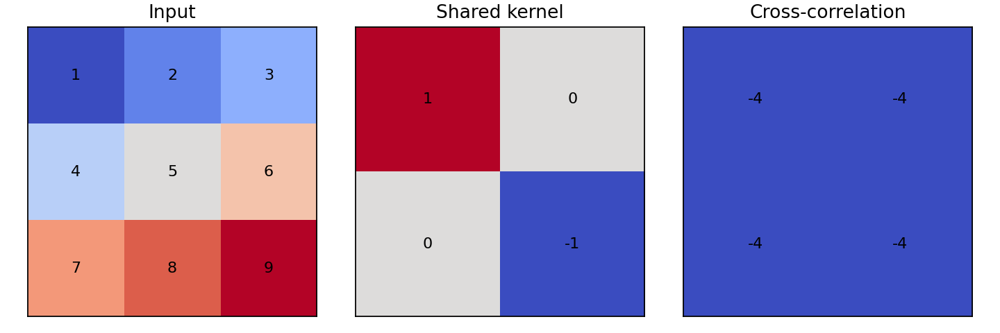
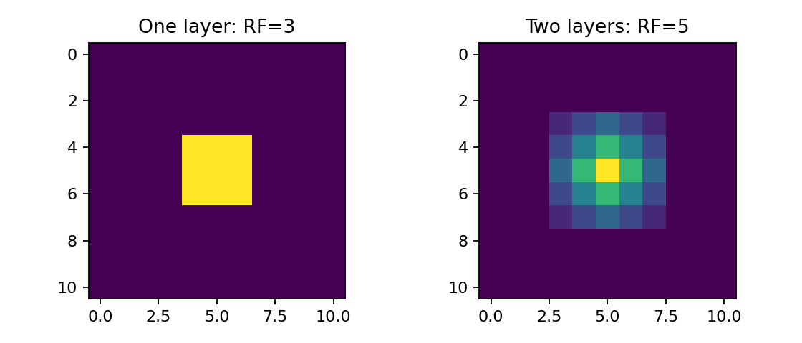
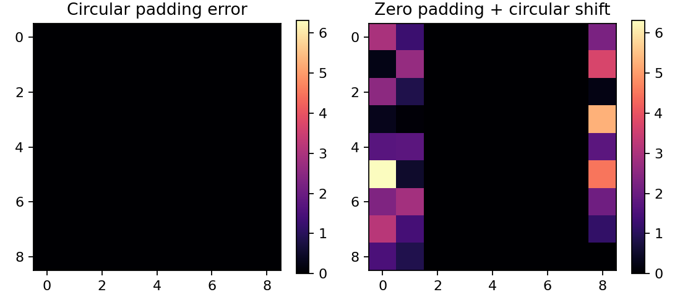

# 第091课 卷积的计算与归纳偏置

本课问题：为什么图像中同一个小图案，不必在每一个位置重新学习一遍？答案藏在两个约束中：局部连接规定每个输出先看邻近像素，参数共享规定不同位置使用同一个检测规则。这些约束减少了自由度，也把一种关于世界的假设写入模型。

直接先修：009至010、083、085至086。你只需知道数组索引、乘加、链式法则。本课从一个可手算的算子出发，自己实现前向与反向，然后用CPU框架和有限差分交叉检查。没有GPU、在线数据、API密钥或云服务要求。

## 1 从图像数组到局部计算

灰度图像可以保存为高H、宽W的矩阵，彩色图像再有C个通道。通道不是样本：同一个位置的红绿蓝值属于同一张图像。实验采用NCHW布局，N是批量大小，C是输入通道，H/W是空间轴。NumPy常见的HWC图片布局不能不经转置就送入这个实现。

全连接层把所有像素拉平成向量，每个输出都可独立使用每个输入像素。若输入32×32×3，输出同样有32×32×16个空间单元，则仅权重就需3072×16384=50,331,648个。局部3×3卷积只需16×3×3×3=432个权重，再加16个偏置。减少参数的原因不是“计算没有发生”，而是同一组432个数被反复使用。这个数字比较刻意固定输出单元数量，不能把不同任务的全连接分类头拿来随意对比。

归纳偏置是学习前就施加的结构偏好。图像局部像素通常有关联，而同一条边缘在不同位置通常仍是同类局部模式，所以卷积常常合适。但天文位置、医学扫描坐标、地图方向等任务可能需要绝对位置；共享规则并非普适真理。

## 2 先做四次乘加，再谈术语

输入X与核K取为

$$X=\begin{bmatrix}1&2&3\\4&5&6\\7&8&9\end{bmatrix},\qquad K=\begin{bmatrix}1&0\\0&-1\end{bmatrix}.$$

没有补边，步长为1。左上角输出是1×1+2×0+4×0+5×(-1)=-4。向右移动一个像素，得到2-6=-4；向下也相同。输出为2×2的全-4矩阵。这里核没有翻转，这种运算准确地说是互相关。

数学卷积先将二维核旋转180度再做相同局部乘加。本例翻转后核为[[-1,0],[0,1]]，输出变成全4。深度学习框架通常把不翻转的互相关称作卷积。对从头学习的自由参数，两种约定通常可以通过重命名权重互相表示；但导入固定滤波器、复现算法和核验数字时，约定必须一致。[PyTorch Conv2d文档](https://docs.pytorch.org/docs/stable/generated/torch.nn.Conv2d.html)明确其计算采用互相关。

图1全部数字由实验代码产生。不要从颜色猜正负，要逐项核对数字。

## 3 一条公式包含所有轴

设输出通道数为O，核为K高×K宽。权重W的形状为(O,C,K高,K宽)，偏置b的形状为(O)。输出的一个元素是

$$Y_{n,o,i,j}=b_o+\sum_{c=0}^{C-1}\sum_{u=0}^{K_h-1}\sum_{v=0}^{K_w-1}W_{o,c,u,v}\,\widetilde X_{n,c,is_h+ud_h,js_w+vd_w}.$$

这里X上方的波浪表示已经补边的输入；s为步长，d为空洞率。每个输出通道有一组覆盖所有输入通道的核。不同输入通道的响应相加形成一个输出通道，不是每个通道各算各的之后自动得到C×O个通道。

本课从零实现只支持对称零补边、标量步长、d=1和普通稠密卷积。公式给出更广的一般情形，但代码未实现的功能不能声称已经验证。先把小子集做正确，比复制大量选项更能训练研究判断。

## 4 输出尺寸从最后一个合法窗口推出来

补边后高度为H+2p。空洞率d使K个采样点跨越的实际宽度为d(K-1)+1，称有效核大小。第i个窗口左上角位置是is。窗口末端不能超过输入末端，因此

$$is+d(K-1)\le H+2p-1.$$

将i的最大整数值再加1，得到

$$H_{out}=\left\lfloor\frac{H+2p-d(K-1)-1}{s}\right\rfloor+1.$$

宽度同理。H=5、K=3、p=1、s=2、d=1时，输出高度为3。窗口起点为0、2、4；补边后高度7，最后一个窗口覆盖4、5、6。若误写成简单H/s，就会得到非整数或丢掉边界。

对于奇数核、s=1、d=1，p=(K-1)/2保持空间尺寸。偶数核若想保持尺寸，往往需要两侧不等量补边。框架的“same”约定可能限制步长或采用非对称补边，不能只凭名字推断具体像素对齐。连接两个分支前，除了形状，还要检查它们表示的空间坐标是否一致。

## 5 三种常被混淆的计数

普通卷积参数量为O(CK_hK_w+1)，若不使用偏置则去掉O。批量大小与图像尺寸不改变这组共享参数的个数。

一次前向的乘加次数（MAC）为NH_outW_outOCK_hK_w。若约定一次乘法和一次加法分别算一次浮点运算，常用近似FLOPs=2×MAC；这里未计偏置、激活、访存、补边和反向传播。报告时写明口径，不要把一个库给出的MAC与另一个库的FLOPs直接比较。

例如一张32×32×3图像经16个3×3核、步长1、补边1，输出32×32×16，参数448个，MAC=442,368，近似FLOPs=884,736。参数量小并不意味着计算量小，因为共享权重要在许多位置被重复使用。峰值内存还依赖中间激活和后端算法，不等于模型文件大小。

## 6 感受野是沿路径累计的

感受野表示某个输出可能依赖的输入范围。第l层输出相邻单元在原图上的间隔称跳距j_l；r_l是感受野边长。令r_0=j_0=1，则

$$j_l=j_{l-1}s_l,\qquad r_l=r_{l-1}+(k_l-1)d_lj_{l-1}.$$

推导直觉：当前核覆盖k个位置，相邻位置在原图隔着j个像素，所以首尾额外跨度是(k-1)dj。先有3×3步长1，再有3×3步长1，感受野为5而不是3。若第一层步长2，第二层步长1，则r为3→7，j为2→2。三个3×3步长1层可看7×7范围，但与一个7×7线性核并不相同，因为中间还有通道与非线性。

图2用全1核，以中心一个输出对输入求导。非零范围分别为3×3和5×5；两层的中心梯度更大，因为有更多路径通过中心。理论感受野只是可能依赖区域，实际梯度分布还受权重、ReLU门和训练影响。边界位置的一部分理论感受野落在补入的常数上，并没有看到更多真实图像。

## 7 为什么共享带来等变，而不是自动不变

记T为平移算子，C为卷积。在无限网格上、步长1且约定相容时，C(TX)=T(CX)。平移输入让响应图跟着平移，叫平移等变。若f(TX)=f(X)，输出完全不变，才叫平移不变。猫从左移到右，响应峰也从左移到右，是等变的直觉。

有限图像必须定义边界。本实验用循环平移搭配循环补边得到近机器精度的等变；循环平移搭配零补边则破坏边界约定的一致性，产生明显误差。它演示的是边界假设的重要性，并不声称所有零补边平移在所有内部位置都失败。步长大于1还只对与采样网格相容的平移保留相应关系；一像素平移可能改变采样相位。

卷积的限制也从这里看出：它不会自动保证旋转、缩放、透视变换的不变性。要获得这些鲁棒性，可能需要增强、任务设计、几何结构或更广的数据支持。

## 8 反向传播：共享权重就必须累加梯度

令G为损失对输出Y的梯度。每个局部输出都用了同一个W，因此

$$\frac{\partial L}{\partial W_{o,c,u,v}}=\sum_{n,i,j}G_{n,o,i,j}\widetilde X_{n,c,is+u,js+v},\qquad \frac{\partial L}{\partial b_o}=\sum_{n,i,j}G_{n,o,i,j}.$$

输入梯度也要将所有覆盖该像素的窗口贡献相加：对每个输出位置，把G_{n,o,i,j}W_{o,c,u,v}加回对应输入位置。这就是代码中+=的理由。若误写赋值，最后一个窗口会覆盖先前贡献，边缘可能“看起来对”，中心却错得最多。

手算反传：3×3全1输入、2×2全1核、损失为全部输出之和。每个核元素被用4次，所以核梯度均为4；偏置梯度为4。输入梯度为[[1,2,1],[2,4,2],[1,2,1]]，因为中心像素被四个窗口看到，角点只被一个看到。此例已经写入自动测试。

## 9 三角核验，避免两个错误互相附和

第一条证据是手算，检查算子定义；第二条是NumPy循环与PyTorch双精度前向及梯度对照，检查批量、通道、步长和padding；第三条是中央有限差分，检查一个权重方向：

$$\frac{\partial L}{\partial w}\approx\frac{L(w+\epsilon)-L(w-\epsilon)}{2\epsilon}.$$

实验取ε=10^-6，使用随机上游梯度G构造标量L=ΣYG。随机G比全1更能暴露索引错误。过大ε有截断误差，过小ε有浮点相消；不应要求所有差分等于零。框架比较采用float64以便严格检查；性能实验则通常用float32。

本课核验三组(stride,padding)：(1,0)、(1,1)、(2,1)，同时使用批量2、输入通道2、输出通道3、非方形图像与非方形核。这些不对称形状能暴露把高宽轴交换的错误。输出JSON记录实际最大绝对误差，测试门槛为10^-7。

## 10 从阅读代码到独立修改

corr2d先补边，按合法窗口逐一取patch，再与同一核逐项乘加。backward复用完全相同的位置映射；dx先写入补边后的数组，最后裁回真实输入范围。padding=0时必须单独处理，否则Python的0:-0会返回空数组。

这个实现追求透明，不追求速度。框架可能把窗口变换成矩阵乘法，也可能使用专用算法；数学等价不意味着实现路径相同。先用从零版本做小规模真值机，再用优化实现做实际训练，是有价值的研究工作流。

## 11 练习与验收

1. 输入7×9、核3×5、步长2、两轴补边1，输出形状是什么？
2. 输入通道4、输出通道6、核3×3、含偏置，参数多少？输出8×8时单张MAC多少？
3. 三层(k,s)分别为(3,1)、(3,2)、(3,1)，感受野与跳距是什么？
4. 若输入平移后分类标签不变，能否据此断言中间卷积特征不变？
5. 删除backward中的一个+=，预测哪个手算例子会失败，然后运行验证。
6. 把固定核旋转180度，解释输出符号变化，而不是把框架判为错误。
7. 将有限差分ε依次改为10^-2、10^-4、10^-6、10^-8，画误差并解释浮点影响。

验收必须同时提交手算、形状推导、三组前向与梯度误差、边界误差图，并清楚写出实现不支持的功能。只展示一张“边缘提取很好看”的图不算通过。

## 12 本课结论与来源

局部连接限制每个输出的输入范围，参数共享限制不同位置的计算规则；二者合起来形成卷积的归纳偏置。感受野沿网络累计，等变性依赖步长和边界约定；梯度则必须累加所有共享与重叠路径。

定义核验来源：[PyTorch Conv2d官方文档](https://docs.pytorch.org/docs/stable/generated/torch.nn.Conv2d.html)。本课推导、手算、合成数组与图均为教学原创；运行结果以outputs/results.json为准。
