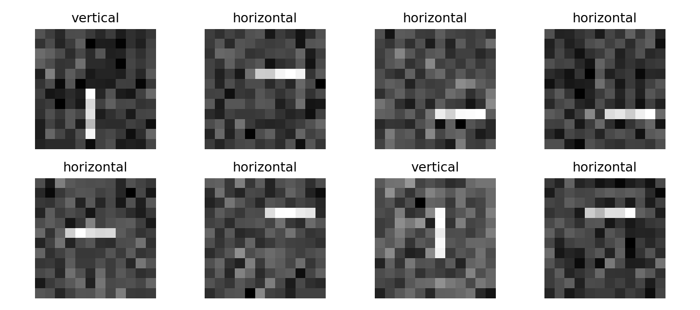
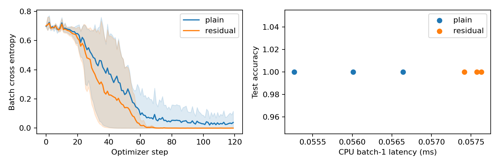
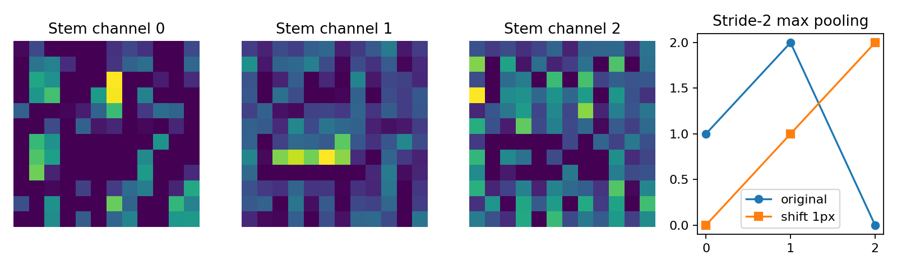

# 第092课 卷积网络与视觉表示

本课问题：在卷积之上加入池化、残差与多尺度，究竟改变了什么？我们不把CNN理解为若干层名称的堆叠，而是把它理解为一套可检验的选择：保留什么空间信息、允许什么信息混合、怎样让梯度传播，以及用什么资源换取什么能力。

直接先修：087、089、091。需要理解链式法则、激活函数、卷积形状与感受野。实验完全在CPU运行，数据由本地代码生成，无需下载图片或接入任何服务。终点是能够在一致预算下比较两种模型，并诚实描述没有观察到差异时的结论。

## 1 从“看见边缘”到“区分图案”

第一层卷积将小邻域映射到若干通道，每个通道是一种可学习的响应。后续层把相邻响应组合起来，感受野逐层增大，于是可能从局部强度变化组合到纹理、部件或任务相关结构。这里的“可能”很重要：网络没有被强制要求某一通道代表眼睛，更不能只凭一张漂亮的激活图证明它理解了物体。

本实验任务故意很小：12×12灰度图中有一条水平或垂直短线，位置随机，叠加高斯噪声。标签仅表示方向。位置不应该改变标签，因此共享局部规则是合适的先验。数据来自清楚可控的生成器，能隔离结构与优化；但它没有真实照片的遮挡、背景、纹理与分布变化，不能充当自然视觉能力基准。

图1示例直接来自训练数组。训练集384张、测试集256张，生成种子分开；标签在每个集合中平衡。训练与测试共享生成机制，因此是在同分布条件下评估，而不是检验领域迁移。

## 2 等变、不变与鲁棒的三个层次

若平移输入使特征图相应平移，叫等变：f(Tx)=Tf(x)。若输出完全不变，叫不变：g(Tx)=g(x)。若输出虽有变化但不影响任务，或变化可控，通常说具有一定鲁棒性。这三者不能互换。

卷积步长1在相容的空间域与边界条件下给出等变关系。分类头可能借助空间汇聚将等变特征转成近似不变的类别判断。定位任务却需要保留物体在哪里；把所有空间位置平均掉，会失去精确定位信息。因此“更不变”不是在所有任务上都更好。

实验测试集右移一像素后仍全部分类正确，但概率发生微小变化。这恰好说明标签稳定不等于函数输出严格不变；更不等于任意幅度、任意方向、任意边界截断下都稳定。

## 3 池化：少看一些位置，代价是什么

最大池化在窗口内取最大值，平均池化取平均值。对2×2窗口[[1,3],[2,0]]，最大池化输出3，平均池化输出1.5。最大池化保留最强响应，平均池化保留总体强度；两者都丢失窗口内排列信息。

反向传播时，平均池化把上游梯度均分给四个位置；最大池化通常只传给选中的最大位置。若多个位置并列最大，不同实现的索引约定可能决定梯度路由，应检查框架行为，不宜在不可微点用有限差分下武断结论。[MaxPool2d官方文档](https://docs.pytorch.org/docs/stable/generated/torch.nn.MaxPool2d.html)给出了其窗口计算及形状约定。

池化不保证一像素平移不变。考虑一维输入[0,1,0,2,0,0]，窗口2、步长2，最大池化为[1,2,0]。循环右移一位后输入[0,0,1,0,2,0]，输出为[0,1,2]。响应跨过窗口边界，结果就改变了。所谓局部不变性，是特征在同一汇聚窗口内移动、且其他条件合适时可能保持响应，而不是无条件的数学保证。

下采样还会混叠：高频变化可能在稀疏采样后呈现为不同低频模式。先平滑再下采样有助于降低某些混叠，但会抹去细节，也不能自动解决所有视觉变化。步长卷积是可学习的降采样，不应把它默认为已经学会适当的抗混叠滤波。

## 4 全局平均池化如何产生分类表示

设最后特征图A形状为C×H×W，全局平均池化得到长度C的向量

$$z_c=\frac1{HW}\sum_{i,j}A_{c,i,j}.$$

线性分类头计算l_k=Σ_c U_{k,c}z_c+b_k。若空间变换只是把相同特征值重新排列，平均值不变，所以这种汇聚能消除排列带来的变化。但零补边、裁剪和步长可能改变特征值本身，并不只是重排，所以整个网络仍不一定严格不变。

手算：两通道分别为[[1,0],[3,0]]与[[0,2],[0,2]]，汇聚后都是1。第一类头权重[2,-1]、偏置0，分数为1。若第一通道响应平移但不丢失数值，分数不变；若强响应3被裁出边界，第一通道均值变为0.25，分数便变为-0.5。分类不变性的条件由此一目了然。

全局平均池化的参数为零，但操作与访存并不是零。它减少了分类头参数，也施加了“位置可汇总”的任务假设。用flatten加全连接保留更多位置敏感性；选择哪一种取决于标签是否依赖绝对位置。

## 5 为什么残差支路改变优化问题

普通块学习y=F(x;θ)，残差块学习y=x+F(x;θ)。若希望整个块接近恒等映射，残差块只需让F接近0，而普通块要在参数中实现x本身。恒等旁路是一个直接的信息与梯度路径。

对可微的加法块，雅可比为

$$\frac{\partial y}{\partial x}=I+J_F(x).$$

若损失对y的梯度为g，传给x的梯度是g+J_F(x)^Tg。第一项没有经过F的权重链。这解释了残差为什么可能帮助传播，却不是“永不梯度消失”的保证：两项可能相消，支路仍可能不稳定；若加法后还有ReLU，则还需乘该ReLU的门控导数。

本实验具体使用y=ReLU(F(h)+h)，所以其局部雅可比为D_ReLU(I+J_F)。不能把纯加法块的公式不加条件地套到完整网络。作为对照，普通块为ReLU(F(h))。两者有相同卷积层，唯一区别是加法旁路。

原始残差网络论文提出并验证了深网络的残差学习框架：[He等，Deep Residual Learning for Image Recognition](https://arxiv.org/abs/1512.03385)。本课小型实验并非复现论文的大规模结果，只验证结构机制与比较流程。

## 6 相加前先问：形状与坐标是否一致

残差相加需要两个张量形状相容。若主支路把通道从8变16，或把空间尺寸减半，原输入不能直接相加。常用1×1卷积投影P(x)调整通道，并通过步长调整尺寸：y=F(x)+P(x)。此时梯度路径是J_P+J_F，不再是严格的I+J_F，投影也增加参数和计算。

1×1卷积在每个像素位置混合通道，不直接扩大空间感受野；例如从32通道映射到8通道，每个位置完成一个8×32的线性变换。它可以压缩通道以减少后续3×3卷积计算。若先32→8，再8→8的3×3，再8→32，则仅权重分别为256、576、256，合计1088；直接32→32的3×3为9216。两者结构能力与非线性不同，因此不能只根据计数断言性能相同。

本课两个网络都保持12×12、8通道，不需要投影。这样能把残差连接这一变量隔离出来，避免同时改变宽度、深度与采样尺度。

## 7 多尺度：同一物体可能占五个像素，也可能占五十个

单一局部尺度难以同时处理细节和大结构。多尺度可以来自逐层增大的感受野、不同分辨率的特征、并行不同大小的核，或空洞卷积。它们不是完全等价的手段。

两个3×3步长1层理论感受野为5×5，三个为7×7；中间非线性使它们与单个大核不同。空洞率2的3×3核有效跨度为5，但只采9个点，可能留下采样间隙。下采样扩大后续层在原图上的跳距，但丢失精细空间分辨率。保留高分辨率分支能服务定位，却增加激活内存。

用一个具体路径计算：3×3步长1卷积后接2×2步长2池化，再接3×3步长1卷积。感受野依次为3、4、8，跳距依次为1、2、2。最后一层虽只有3×3核，已依赖原图8×8范围。若研究小目标，需检查降采样是否在形成足够特征前就把信号抹掉。

本课实验不加入多尺度分支，避免一次改动多个变量。扩展作业可加入一个池化尺度，但必须重新核算形状、资源，并设计消融。

## 8 本课模型逐层展开

输入(N,1,12,12)。stem为1→8通道的3×3卷积、补边1，接ReLU，输出(N,8,12,12)。主支路再有8→8的3×3卷积、ReLU、8→8的3×3卷积。普通模型直接接ReLU；残差模型先与stem输出相加，再接ReLU。最后全局平均得到(N,8)，线性头得到(N,2)。

参数逐项为：stem 8×1×9+8=80；两个8通道卷积各8×8×9+8=584；分类头8×2+2=18。总计80+584+584+18=1266。残差加法没有参数，因此两个网络参数相同。

单样本卷积与线性层MAC为12×12×(72+576+576)+16=176,272。若乘加算两次FLOP，近似352,544。残差另加8×12×12=1152次标量加法。报告中把这1152单列，不能说两者“总运算量完全相同”。激活、偏置、均值汇聚与访存未计入该FLOPs口径。

## 9 公平预算不是一个含糊形容词

实验使用三个配对种子。每对模型加载完全相同的初始参数张量，使用同一个预生成batch索引序列，Adam学习率0.01、batch32、120次更新。每次运行总共看3840个训练样本位置，允许重复抽样。两个模型有相同卷积/线性MAC，残差加法是额外开销。

这叫相同更新步数、样本数与近似核心计算预算，不是相同墙钟时间。若研究目标是固定0.3秒谁更好，需另做固定时间协议；若关注达到某个精度的成本，则比较达到阈值的步数与时间。不同预算对应不同研究问题，不能混写。

测试集只用于既定配置的最终评价，不据其准确率反复调参。本小课没有调参阶段，所以没有另外划验证集；扩展实验如需选学习率、宽度或训练长度，必须增加独立验证集，并保留测试集直到最后。

左图实线为三种子均值，阴影为最小至最大范围，不是置信区间。右图每个点对应一次训练后的模型测量。不要把短实验里的细微计时差异当稳定工程排名。

## 10 实际结果：没有差异也是一种结果

本次CPU执行中，普通与残差模型在三个种子上均得到测试准确率1.0，右移一像素后的准确率也均为1.0。任务已经饱和，因此准确率无法区分两种结构。损失轨迹因种子和结构而不同，但不能据一个较低的最终batch损失宣称泛化更好。

普通模型batch1中位延迟约0.055至0.057毫秒，残差模型约0.057至0.058毫秒。这是当前CPU、单线程、float32、预热20次后测100次的本地结果，不是设备无关指标。每个模型都同时记录中位数与90分位数，训练用时则包括前向、反向、优化器步骤。测试数据生成和模型初始化不计入训练计时。

参数相同仍可能延迟不同，因为残差增加读写与加法，算子调度也有开销。反过来，参数更少的深度可分离卷积在某些后端也未必更快；内存、并行度和实现效率共同决定延迟。论文应报告真实设备与实测，不以参数量替代延迟。

## 11 可视化能说明什么，不能说明什么

前三幅是最后一个残差模型在同一测试样本上的三个stem通道。它们展示响应位置和强弱，不是通道“语义”的充分证据。若想给通道命名，需要跨多个样本检验、统计响应、控制输入扰动，并排除只看最好案例的选择偏差。

右图是前述池化反例的真实数组。把一个明确反例与一组成功分类放在一起，是为了训练边界意识：经验上的标签稳定和理论上的严格不变可以同时不同成立。

## 12 代码阅读顺序与故障诊断

先读data，确认标签没有被噪声或增强破坏；再读SmallCNN.forward，逐层写形状；随后读配对初始化和batch生成；最后读训练、推理、资源统计。train/eval在此没有BN或dropout时不会改变这些层的数学输出，但显式切换保留了清晰的协议，也便于以后正确加入这些层。

zero_grad(set_to_none=True)清除上一轮梯度，loss.backward计算当前梯度，opt.step更新参数。若忘记清梯度，实验就不再是声明的逐batch优化；若把test_x用于训练，测试准确率不再代表未见样本表现。延迟测量用inference_mode避免构建自动求导图，预热减少首轮初始化影响，并固定单线程以降低部分变动。

测试文件检查生成器可复现、输出形状、参数计数、所有参数梯度存在且有限，以及残差支路置零后仍有恒等信息通路。测试不要求残差必须胜出，因为那不是数学必然，也不是该简单任务支持的结论。

## 13 练习与研究设计

1. 手算2×2最大池化与平均池化的前向及反向；说明并列最大为什么需要约定。
2. 将普通块主支路输出设为0，与残差块比较。若加法后有ReLU，哪些输入仍会被截断？
3. 从8通道变16通道、空间减半时，设计投影支路并计算新增参数。
4. 解释本实验六次准确率均100%为什么不支持“残差一定更好”，也不支持“残差无用”。
5. 把短线长度改为3、5、7，定义一个不泄漏的多尺度评估方案。
6. 设计固定墙钟预算与固定样本预算两个协议，分别说明要控制什么。
7. 用三个种子的完整结果写结论，而不是挑一条最好曲线。

验收交付：逐层形状、参数与MAC手算、两个结构的相同预算协议、三个种子完整结果、真实延迟及口径、一个平移反例、至少一项没有被实验支持的结论。答案见answers.md。

## 14 下一步

本课形成的是视觉模型比较的最小研究习惯：先说明要保留哪些信息，再设计结构；先匹配预算，再比较；先报告局限，再讨论推广。下一课把表示用于迁移学习、分类、检测和分割时，还需要审计预训练信息、任务指标与数据重叠。

来源：[He等原始残差论文](https://arxiv.org/abs/1512.03385)、[PyTorch MaxPool2d官方文档](https://docs.pytorch.org/docs/stable/generated/torch.nn.MaxPool2d.html)、[PyTorch Conv2d官方文档](https://docs.pytorch.org/docs/stable/generated/torch.nn.Conv2d.html)。合成数据、实验代码及三幅图均为教学原创。精确运行数字以outputs/results.json为准。
