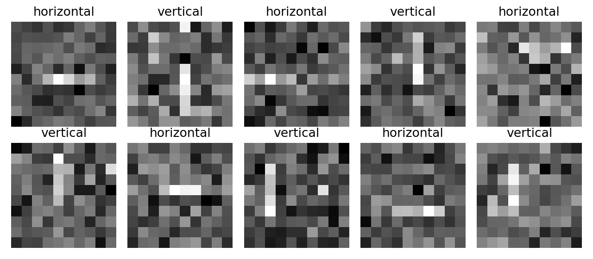
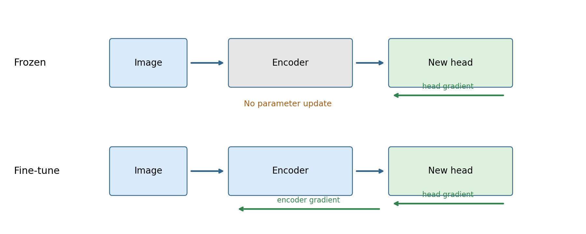
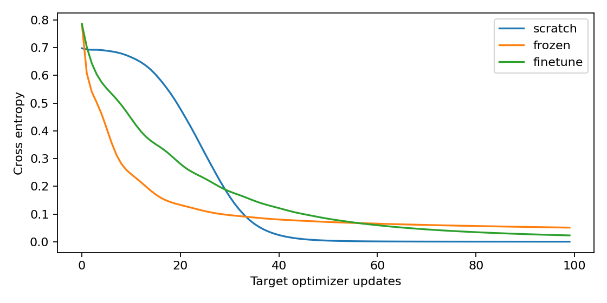

# 第093讲 视觉任务与迁移学习

本讲从第092讲的卷积表示出发，回答一个现实问题：已经训练好的特征，能否减少新任务需要的标注和训练？学完后，你应能画出冻结与微调的计算图，解释分类、检测、分割评价单位的差异，手算IoU和一对一匹配，并检查图像重复是否使测试失去独立性。

直接先修：046、050、052–053、086、090、092。若忘记交叉熵，先记住它惩罚模型给正确类别过小的概率；若忘记梯度，先把它理解为参数改变一点时损失变化的方向。本讲不要求下载大模型。我们在CPU上从头产生一个小型源任务模型，再把它迁移到更噪的目标数据，因此每一份数据来源都可以审计。

蓝色表示核心原理，绿色表示本次实验能支持的观察，橙色表示错误风险。颜色之外保留文字标记，黑白打印也能辨认重点。

## 1 贯穿案例 为什么旧经验可能帮到新任务

设一个工厂先在清晰相机下收集短线图像，后来更换相机，图像噪声增大，但仍需辨别水平线与垂直线。源数据有256张清晰图，目标训练数据只有40张；另外生成200张目标测试图，直到评价才使用其标签。标签规则相同，像素分布有所改变。这个例子属于受控的输入分布变化，不是跨物种、跨医院或跨语言迁移。

我们希望源模型已学到对方向有用的局部结构，而不是记住某一张图。如果这些结构对目标图仍有帮助，少量目标标签就能训练分类头。若噪声改变了哪些结构可靠，允许编码器调整可能有益，也可能在40张图上过拟合。迁移是一个需要对照实验验证的假设。

图中横线不一定出现在中间。随机位置阻止模型仅检查固定中心像素；噪声让简单规则不再完全可靠。训练、源数据与测试使用不同生成种子。种子不同只能避免伪随机流完全重复，不能自动保证现实采集中的主体独立。

## 2 把模型拆成编码器与预测头

用x表示图像，编码器fθ把像素变成特征h，预测头gφ把特征变成类别分数。模型是gφ(fθ(x))。θ和φ是两组参数。我们的编码器有两层3×3卷积、ReLU以及全局平均池化，输出8个数；分类头把这8个数映射成两个分数。

$$h=f_\theta(x),\qquad p(y=k\mid x)=\frac{\exp(g_\phi(h)_k)}{\sum_j\exp(g_\phi(h)_j)}.$$

这里的特征不必对应人类命名的对象。某一个通道可以同时受边缘、噪声和位置影响。给通道取一个好听的名字，并不能证明它只识别那个概念。

源任务训练更新θ和源头参数。目标任务通常重新初始化头，特别是类别数量或类别含义改变时。本实验源和目标恰好都有两个类别，但仍重置目标头，以隔离“搬运表示”的作用。若直接搬运整个分类器，应明确这又是不同条件。

## 3 冻结与微调的精确区别

冻结是把源θ视为常数，只优化目标φ。损失仍可计算，预测仍可改变，但编码器参数不更新。PyTorch中设置requires_grad为False，并只把可训练参数交给优化器。实验记录训练前后编码器最大绝对参数差，冻结条件应严格为0。

微调允许θ和φ一起更新。目标梯度通过预测头传回编码器：

$$\nabla_\theta L=J_{f_\theta}(x)^\top\nabla_h L.$$

这句话的通俗解释是：分类头告诉特征“哪些方向能减少错误”，编码器再修改卷积核，使这些方向更容易出现。小学习率是常见的保守起点，但不是普遍最优。本实验微调学习率0.005，另两组为0.02，因此比较的是预先指定的训练方案，不能将差异全部归因于是否解冻。

误区：冻结参数等于进入推理模式。两者不同。BatchNorm运行统计和Dropout行为由train/eval控制；参数requires_grad只影响自动微分。本实验编码器没有这两类层，避免把这个额外变量藏进比较。

手算一个最小模型：h=θx，预测为φh，L=(φθx−y)²/2。令x=2，y=1，θ=1，φ=0.4，则预测0.8，误差−0.2。对φ梯度为−0.4，对θ梯度为−0.16。学习率0.1时，冻结只令φ变0.44；微调还令θ变1.016。即使一步预测相近，允许变化的模型空间已经不同。

## 4 公平比较至少需要三个参照

从头训练组：随机编码器加随机头，全部训练。冻结组：源编码器固定，新头训练。微调组：源编码器初始化，新头训练，全部更新。三组都用同一40张目标训练图与200张测试图，各做100次目标更新，目标头初始化按种子配对。

源模型训练另有120次更新，不能因为发生在“预训练阶段”就把其成本说成零。本实验三个目标种子共享同一份源模型，所以它们只反映目标初始化变化，没有覆盖预训练随机性。若研究预训练稳定性，应再独立重复源训练。

相同更新数不是相同运行时间，更不是相同浮点运算量。冻结不为编码器保存反向计算图，微调需要。公平性的关键是先声明你控制的是目标数据量、更新预算、总算力，还是其中几项，然后报告没有控制的部分。

图2只画seed=0，其他种子的最终值在实验结果表中全部保留。曲线是训练损失，不能从中直接读出目标测试准确率；低训练损失也可能来自对40张训练图的记忆。

## 5 数据增强先问标签是否仍成立

增强是对输入施加变换T。如果继续使用旧标签，就隐含假设y(Tx)=y(x)。在方向任务中，小幅加噪或不裁掉线段的平移可能保持标签；旋转90度会把水平变成垂直，原标签必须改变。把这类旋转当作无标签变化增强，实际上是在制造互相冲突的监督。

分类中的随机裁剪也不一定保持标签：若裁剪把唯一目标完全移走，图片里已经没有该类别实例。检测必须同时变换边界框坐标；分割必须以对应几何变换处理像素标签，且标签插值不能随意采用会产生小数类别的双线性插值。

判断步骤是先写标签语义，再画变换前后样本，最后查实现是否同步改变标注。不要因为某个增强在大型数据集上常用，就假定它在医疗、文字方向或精确测量任务上安全。

## 6 三种视觉任务的评价单位

分类每张图输出一个类别。准确率是正确图数除以图数；类别失衡时还应检查每类召回率。检测输出多个带类别与置信分数的框，必须回答“这个预测框对应哪个真实对象”。分割给每个像素一个类别，需要评价区域重合并处理背景占比。

同一张带两条线的图片，在分类任务里可能只需回答是否存在竖线；检测要分别找到每个对象；分割要标出每个对象占据的像素。图像级分类正确，不说明定位也正确。不能把分类准确率的含义直接搬给检测或分割。

## 7 IoU从集合开始推

IoU是交集面积除以并集面积。设A、B分别为真实框和预测框覆盖的区域，交集表示双方都覆盖的位置，并集表示至少一方覆盖的位置：

$$\mathrm{IoU}(A,B)=\frac{|A\cap B|}{|A|+|B|-|A\cap B|}.$$

为什么分母减去交集？直接把两个面积相加，会把重叠部分数两次。手算A=[0,0,2,2]，B=[1,0,3,2]：两个面积都为4，交集是宽1高2的矩形，面积2，并集6，所以IoU=1/3。本讲框坐标使用连续半开区间，不在宽高中加1。

若两框不相交，交集宽或高为0，IoU=0。若区域完全相同，IoU=1。零面积框属于非法输入，代码主动拒绝；空分割区域是另外一种需要明确约定的情况，不能混为一谈。

## 8 检测匹配为何不能重复认领

考虑同一类别的两个真实框G1和G2，三个预测P1、P2、P3按置信度0.9、0.8、0.7排序。设P1与G1的IoU=0.8，P2与G1=0.7且与G2=0，P3与两个真实框均小于0.5。阈值为0.5时，P1认领G1成为TP；P2重复认领已匹配的G1成为FP；P3也为FP；G2未找到成为FN。

因此这三个预测的precision=1/3，recall=1/2。若只保留前两个预测，则TP=1、FP=1、FN=1，precision=recall=1/2，这正是脚本记录的两预测手算例。先固定类别、IoU阈值、置信度排序和一对一规则，结果才可复核。

改变置信度阈值得到精确率-召回率曲线，AP对这条曲线进行规定方式的汇总。不同数据集的插值、IoU阈值与类别平均规则可能不同。本讲不把单一阈值下的precision叫AP，也没有实现完整COCO评价器。

## 9 分割里高像素准确率可能掩盖失败

假设4×4图里真实前景4个像素，预测前景也4个，其中重叠3个。TP=3，FP=1，FN=1，TN=11。前景IoU=3/(3+1+1)=0.6，Dice=2×3/(2×3+1+1)=0.75，像素准确率=(3+11)/16=0.875。

如果前景只占一百个像素中的一个，永远预测背景也有99%像素准确率。于是必须报告前景或逐类IoU、类别平均规则和空类处理，而不是只报一个漂亮总体值。Dice与IoU有关：对非空并集，Dice=2IoU/(1+IoU)，所以它们不能当作两份独立证据。

## 10 重复与近重复图像审计

完全重复可用原始像素字节的SHA256筛查。近重复可以来自压缩、亮度变化或轻微裁剪，单靠字节哈希会漏掉。本实验将每张测试图与训练图比较像素RMSE，标出小于0.03的候选；这个阈值只对本例像素尺度有意义，不是通用去重器。

我们先审计原始拆分，再人为加入一张训练图及其加0.001的版本。前者必须触发精确重复，后者应触发近重复。注入只发生在审计副本，不污染真正测试集。若真实数据来自同一患者、同一视频或同一原始照片，还需按来源分组，而不是只按文件随机拆分。

没有发现像素重复，只能说本次筛查未发现对应重复形式。它不能证明预训练语料绝无测试重叠，也不能证明所有相似场景相互独立。

## 11 从观察写到结论

本讲结果支持的最窄说法是：在指定线段生成器、40张目标训练样本、固定源模型和预设优化配置下，三种训练方案产生了记录中的测试准确率。它不支持“大规模预训练必然更好”“冻结永远更省总成本”或“已解决真实图像迁移”。

如果冻结表现更差，先查源表示是否区分目标标签，再查线性头是否学好，最后检查源与目标变化是否破坏原特征。若微调不稳定，查学习率、样本量和过拟合。若三组都接近满分，说明任务可能太容易，不能以此证明方法完全等价。

## 12 自检与练习

1. 重做单参数模型的冻结与微调手算，求更新后的两种预测。
2. 说明方向任务中旋转90度时应怎样处理标签，并举一个检测增强需要同步修改框的例子。
3. 手算第7节IoU；解释为什么不能使用交集除以两个面积之和。
4. 对第8节三个预测计算逐前缀precision和recall，说明重复框为何是FP。
5. 把前景交集从3改为2，其他面积不变，重算IoU、Dice和像素准确率。
6. 解释三个目标种子没有覆盖哪一层随机性；提出一个不接触测试集的调参方案。

逐题推导与实验解读见answers.md。动手前先读lab.md中的文件路径与测试说明。

## 参考与边界

[PyTorch迁移学习教程](https://docs.pytorch.org/tutorials/beginner/transfer_learning_tutorial.html)用于核对冻结特征与微调的实现接口。本讲图像、推导示例和小型源预训练实验为原创教学设计，不是该教程真实照片任务的复现。[COCO官方评价代码](https://github.com/cocodataset/cocoapi/blob/master/PythonAPI/pycocotools/cocoeval.py)可用于进一步核对正式检测评价；本讲只手算明确给出的简化例子。
