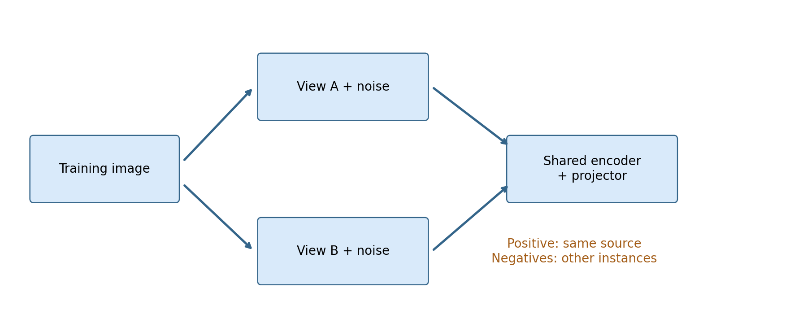
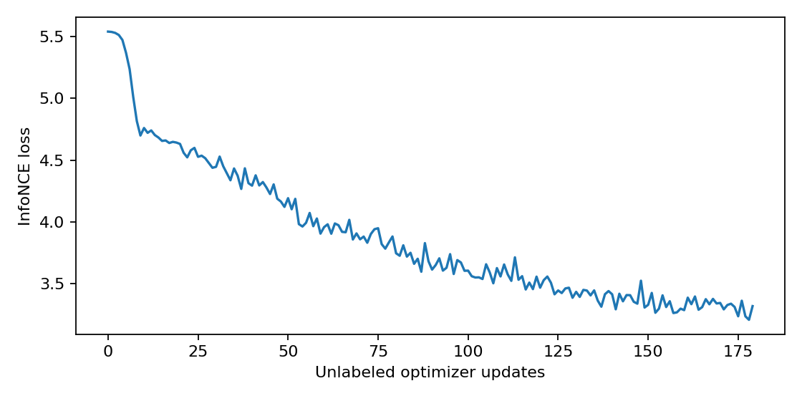
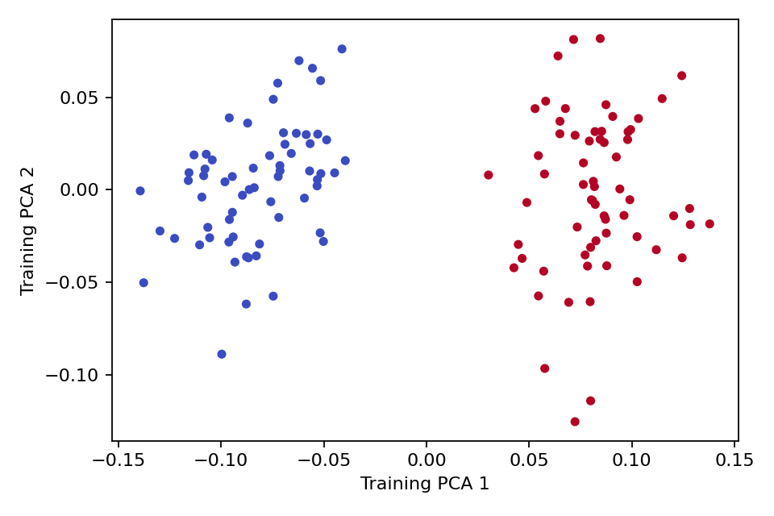

# 第094讲 表示学习与对比目标

本讲研究“没有人工类别标签时，学习信号从哪里来”。我们从监督任务的标签转向两次观察之间的一致性，逐步构造InfoNCE，再用冻结编码器的线性探测检验表示。重点是分清训练目标、表示性质和下游能力，避免把一个损失值误读成通用理解能力。

直接先修：009、043、048、083、086、089。所需数学只有向量内积、softmax、对数和链式法则。贯穿案例仍为随机位置的水平与垂直线，全部数据本地生成。源任务没有人工方向标签参与对比训练，但评价阶段明确使用方向标签。

核心原理：自监督并不是没有监督信号。它把数据构造规则变成训练目标；构造规则的假设决定模型被鼓励保留和忽略什么。

## 1 四种学习设置不要混成一个词

监督学习直接使用目标标签，例如每张图的水平或垂直类别。半监督学习同时使用少量目标标签和较多无标签输入。弱监督使用不完整、噪声较多或粒度较粗的标注，例如只知道视频中某处出现对象。自监督从输入本身构造预测目标，例如遮住一部分、预测上下文，或判断两个视图是否来自同一样本。

这不是互斥的软件库分类。一套系统可以先自监督，再用少量标签监督微调，也可以同时混合不同损失。描述实验时应分别写“哪一步使用了哪些标签”，而不是仅写“无监督模型”。

本实验128张训练图的方向标签在对比阶段不传入损失，仅用于之后训练线性探测器和画有监督颜色的分析图。200张测试图不参与对比训练、投影器训练或探测器训练。因此“没有标签训练编码器”成立，“整个流程从未用标签”不成立。

## 2 表示是为后续任务提供坐标

编码器f把原始输入x变成向量h。好表示取决于后续问题：若只需方向，图案位置和少量像素噪声可能应被忽略；若要定位线段，位置就必须保留。压缩得更小或画起来更整齐，不自动意味着对所有任务更好。

把表示想成地图。地铁线路图保留换乘关系，却不精确保留街道距离；它对坐地铁很好，对计算步行距离可能很差。对比目标同样选择一种“什么应靠近”的规则，而不是发现唯一正确的世界坐标。

## 3 从两个视图定义正例

对同一原始图x独立采样两次增强，得到v和v′。本实验增强是在原图上再加标准差0.08的独立高斯噪声。它没有旋转图形，因此通常保留方向；但高斯噪声没有有界幅度保证，极端扰动仍可能淹没信号。这个增强假设需要通过样本观察检验。

把两个视图经同一编码器得到h和h′，再经同一个投影头g得到z和z′。同源视图构成正例，批中其他原始图的视图作为负例。这里的“负”意指不同实例，不必是不同类别。两条水平线也可能被当作负例，这就是假负例问题。

为何引入投影头？它允许对比损失在一个较专门的空间工作，而探测器使用编码器的输出。这样不等于保证编码器更好；必须实际评价。本实验投影头是8到8的线性层，是简化机制示范，不是完整SimCLR网络与增强配置的复现。

## 4 相似度先归一化再内积

设z不为零，归一化向量为z/||z||。两个单位向量内积等于余弦相似度，范围在−1到1之间。归一化减少“仅靠把向量长度放大就提高某些分数”的路径，使比较主要关注方向。

$$s_{ik}=\frac{z_i^\top z_k}{\|z_i\|\|z_k\|}.$$

手算：z1=(1,0)，z2=(1,1)，z3=(−1,0)。z1和z2的相似度为1/√2，z1和z3为−1。把z2整体乘100，不改变余弦相似度。代码使用F.normalize，它以数值epsilon处理近零范数；零向量不能直接按普通分式解释。

## 5 把配对问题写成分类

一个batch含B个原始样本，每个产生两个视图，一共2B个向量。对锚点i，只有一个指定正例j(i)。我们希望在除去i自身的2B−1个候选中，正确选择j(i)。因此可以使用softmax分类损失：

$$\ell_i=-\log\frac{\exp(s_{i,j(i)}/\tau)}{\sum_{k\ne i}\exp(s_{ik}/\tau)}.$$

τ称为温度，必须大于0。批损失是所有2B个锚点损失的平均。正例也在分母里，因为它是候选之一。自己不在分母里，否则模型可以靠识别同一向量与自己完全相同，改变任务难度。

代码先拼接所有第一视图，再拼接所有第二视图，因此正例索引为(i+B) mod 2B。对B=3，索引0对应3，1对应4，2对应5，反向对应相同。这种约定只对当前排列成立；若把视图交错排列，却仍用这条公式，标签就错了。

## 6 温度如何改变难负例的权重

把分数除以小温度会拉大softmax中相对分数差异。若锚点与正例相似度0.8，与两个负例相似度0.4和0.1，τ=1时正例概率约为exp(0.8)/(exp(0.8)+exp(0.4)+exp(0.1))=0.461。τ=0.2时约为exp(4)/(exp(4)+exp(2)+exp(0.5))=0.858。

这不是说温度越小越好。若某个错误负例与锚点非常相似，小温度可能使它主导梯度。模型可能用实例噪声区分同类图，而破坏任务需要的语义接近性。温度影响优化与假设，应在训练/验证数据上选择，不能看测试准确率后挑选。

令p_ik表示候选softmax概率，对未缩放相似度的导数为：

$$\frac{\partial\ell_i}{\partial s_{ik}}=\frac{p_{ik}-\mathbf1[k=j(i)]}{\tau},\quad k\ne i.$$

对正例，这通常是负数，梯度下降倾向增大其相似度；对负例通常为正，倾向减小其相似度。实际更新还需经过归一化和共享编码器链式法则，所以不能把每个相似度当作可独立任意调整的自由参数。

## 7 坍塌是什么 如何构造可检验反例

若所有输入都变成同一个非零向量，那么所有候选相似度都相同，每个候选概率为1/(2B−1)，损失是log(2B−1)。对于16个视图，损失为log15，约2.70805。脚本用全1向量实际验证这个值。

这个反例说明完全坍塌没有提供区分实例的信息。它也提醒我们，不能只根据表示方差很小就立即断言完全坍塌：尺度可能整体变小，而后续归一化仍保留方向差异。需要结合方差、秩、相似度分布和下游评价检查。

低对比损失不是“语义很好”的证书。若两次增强都保留每张图独有的水印，编码器只识别水印，也可能成功区分正负例；换到无水印任务就失败。

## 8 非对比学习为什么也可能有信号

并非所有自监督方法都显式使用负例。一个思路是预测另一分支的表示，同时采用停止梯度、不同更新速度或额外方差约束；另一个思路是从遮挡输入重建缺失部分。它们改变了避免坍塌或保留信息的机制。

如果仅最小化两个分支输出的平方差，而两个分支都自由学习，常数输出就能使损失为零。因此“去掉负例，保留拉近正例”不是一个完整可靠的方案。本讲没有实现非对比方法，也不声称单个技巧在任意结构下足以避免坍塌。这里是理解设计问题的入口。

## 9 冻结后的线性探测实际检验什么

对比训练完毕后，固定编码器，把h当作数据，只训练线性分类器Wh+b。由于编码器不再改变，评价重点是方向标签能否从已有表示中用一个线性边界读出。它比端到端微调更容易分离表示与适配能力，但仍依赖探测器学习率、训练步数、特征尺度与标签量。

本实验同时保留训练前的随机编码器，用完全相同的线性头初始化、150次更新、学习率0.04作为参照。随机编码器也可能表现很好：卷积、非线性与池化本身已给任务施加有用先验。若没有这个参照，很容易把结构先验的收益全部归给对比训练。

训练损失是否下降，是优化是否取得进展的证据之一。冻结线性探测准确率回答另一个问题。两者应并列报告，不能只挑下降更漂亮的那张图。

PCA投影只在训练表示上拟合，颜色未用于对比目标。二维图丢弃了其他维度，也没有展示测试分布，因此分开看起来像两簇不能替代独立测试。PCA符号可以任意翻转，横轴正负不具备固定语义。

## 10 本次观察与无法推出的结论

本次固定种子实验的随机编码器线性探测已达95.5%，对比编码器为100%。差值4.5个百分点来自这200张固定测试图上的9个预测，不是对所有未来图像的确定提升。我们没有重复多个对比预训练种子，也没有更换下游任务。

实验观察：这组编码器训练后，在指定线段任务上更容易线性读出方向；随机编码器已经是强基线。该结果不能证明学到了通用语义，也不能证明优于有监督预训练。

若要把练习升级为研究，应预先定义多种下游任务、多个训练种子、独立验证集和计算预算，审计正负例中同类冲突。一个有价值的负对照是人为添加实例水印，再评价去掉水印后的新图；这能区分真正方向信息和实例捷径。

## 11 实现检查顺序

先用手工向量核对正例索引，再检查对角线确实为负无穷。然后测试改变行排列并同步改变配对后损失是否保持一致；只打乱表示、不打乱配对应该改变任务。最后检查冻结探测器训练后编码器参数没有变化。

数值实现使用cross_entropy而不是手工exp再log，避免相似度尺度大时溢出。输入含NaN时不应悄悄继续训练；应检查增强、范数和学习率。若batch很小，负例集合也小，对比任务会发生变化，不能把batch变化仅理解为性能优化。

## 12 练习

1. 区分本实验中自监督阶段与监督阶段分别使用哪些数组和标签。
2. B=4时写出8个锚点的正例索引；若错把自身作为正例会发生什么？
3. 用第6节三个分数计算两种温度的损失，解释概率变化。
4. 推导全部表示相同时log(2B−1)的结果；说明它与表示维数是否有关。
5. 为什么两个同方向图可能是假负例？提出一个有代价的修正思路。
6. 为什么95.5%到100%不能直接写成“泛化能力提高4.5%”？请重写成有边界的陈述。

## 参考

[Chen等，A Simple Framework for Contrastive Learning of Visual Representations](https://arxiv.org/abs/2002.05709)是增强视图、投影空间及对比表示学习的重要原始来源。本讲只借用明确的目标形式，采用本地合成数据和极小CPU网络，不复现论文大规模实验。[PyTorch cross_entropy](https://docs.pytorch.org/docs/stable/generated/torch.nn.functional.cross_entropy.html)用于核对数值稳定接口。
