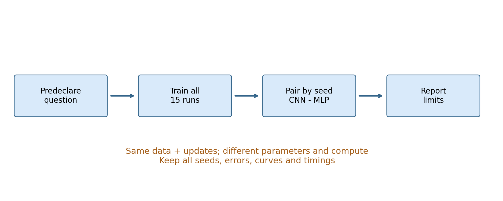
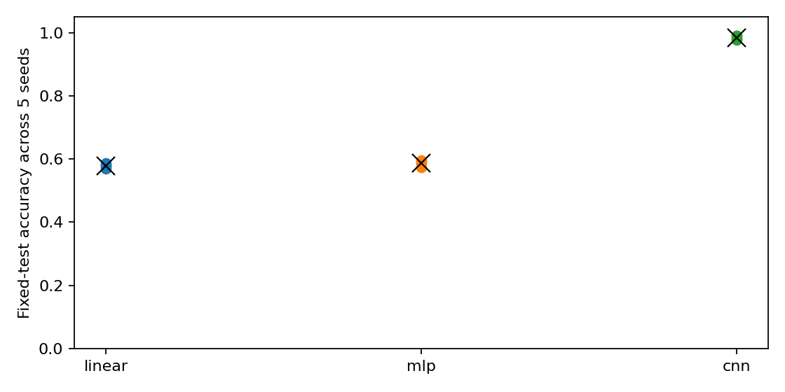
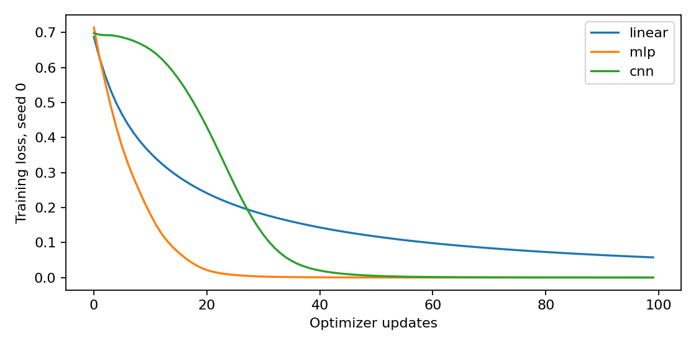

# 第095讲 深度视觉阶段项目

这一讲把前面分散的训练、梯度检查、视觉表示和评价工具组成一项小研究。核心问题是：观察到深度模型更好时，有多少证据能说明收益来自所声称的因素？我们的目标不是制作最强模型，而是交付别人能复查的主张、实现、对照、结果与限制。

直接先修：025–026、050–051、053、085–090；本项目选视觉任务，因此补091–093。若改做自监督，再补094。本讲不使用外部预训练，避免把额外数据藏进结构比较。实验在同一台CPU上运行，保留全部5个种子与3个模型的15次结果。

项目原则：先规定比较对象与成功标准，再运行；把实现正确、训练有效和研究主张成立分开验收。任何一层失败都值得记录。

## 1 把宽泛兴趣缩成可检验问题

“CNN是不是更好”缺少任务、数据、预算和指标。可执行问题是：在固定线段生成器、128张训练图、300张独立测试图、每个模型100次全批Adam更新的条件下，小CNN相对16隐藏单元MLP的测试准确率差是多少？五个配对训练种子的结果是否一致？

这条问题没有宣称控制总FLOPs，也没有宣称控制训练时间。模型结构影响每次更新成本，所以报告参数量与实测训练秒数。把“固定更新预算”写清楚，比含糊地声称“完全公平”更有用。

成功标准包括三部分：手写梯度与有限差分及自动微分一致；15次实验全部产生有限损失和可复查预测；结论正确区分结果、解释与外推。即使CNN没有赢，只要实验能排除某些错误解释，项目依然可以合格。

## 2 数据卡先于训练脚本

每张图为10×10灰度图，含水平或垂直短线，位置随机，叠加标准差0.3的独立高斯噪声。标签由生成器决定，不存在人工标注分歧。训练和测试分别使用种子950与951；每组类别平衡。

这种设置有意保留简单的空间归纳偏置：相同局部方向可在不同位置出现。它适合检验模型是否利用局部共享结构，但它没有自然图像的背景、遮挡或类别多样性。不能称作现实视觉基准，也不能用它支持部署结论。

保存data/images.npz，不仅保存生成种子。因为库版本或生成器实现改变后，同一句“seed=950”未必足以重建同一数组。记录输入数组与代码哈希可以帮助确定差异究竟出在哪里。

## 3 强基线从简单规则开始

线性分类器将100个像素展平，直接输出两个分数，共202个参数。它是简单、透明、训练成本低的参照。MLP先把100维映射到16个tanh隐藏单元，再映射到两类，共1650个参数。CNN使用两层卷积和全局平均池化，参数共享改变了哪些模式容易学习。

为什么不仅比较CNN与一个很差的常数预测器？因为击败过弱基线只能证明任务不是完全不可学。线性模型和小MLP能暴露数据是否已经被简单决策规则解决，也提供更贴近实践的成本参照。

但“强基线”不是永恒称号。本讲三组采用预设超参数，未做系统搜索。如果某组训练曲线仍明显下降，100步可能使其欠训练。应报告这一点，不能把尚未优化好的基线当作结构能力上限。

## 4 用一个手写神经元检查链式法则

设x_i是两维输入，w是两维参数，h_i=tanh(x_i^T w)，以h_i直接预测连续目标y_i。损失为半均方误差：

$$L(w)=\frac1{2n}\sum_i(h_i-y_i)^2.$$

先对h求导，得到(h_i−y_i)/n；tanh导数为1−h_i²；线性输入对w导数为x_i。三段相乘并对样本求和：

$$\nabla_w L=\frac1n\sum_i(h_i-y_i)(1-h_i^2)x_i.$$

这是监督学习最小网络，不是本项目分类器的完整梯度。它的作用是让我们在可手算的位置验证反传理解，再用框架运行较大的视觉模型。不要把一个小函数的梯度检查说成整个CNN所有算子都已独立验证。

手算n=1，x=(1,0)，w=(0,0)，y=1。此时h=0，损失1/2，梯度为(−1,0)。用学习率0.1更新后w=(0.1,0)，预测tanh(0.1)约0.0997，损失下降。第二维输入为0，所以该样本不提供关于第二维权重的信息。

## 5 有限差分不是另一个自动微分

中心差分以两个略微不同的参数值估计斜率：

$$g_k^{FD}=\frac{L(w+\epsilon e_k)-L(w-\epsilon e_k)}{2\epsilon}.$$

实验ε=10⁻⁶，使用float64，并与手写梯度和PyTorch自动微分比较。ε过大会包含曲率误差；ε过小会因两个相近数相减而丢失有效位。选择平滑的tanh和非极端输入，有助于把检查聚焦在实现，而非不可微点或饱和区。

检查失败时，先核对损失平均的位置、是否漏了1/2、矩阵转置和广播，再查数值精度。不能因为自动微分输出了一个数，就认定与数学问题一致；自动微分会忠实求导你写的程序，包括写错的程序。

## 6 配对种子控制了什么

对每个seed=0至4，分别训练线性模型、MLP和CNN。各模型在该seed下初始化，然后使用同一训练数组与同一测试数组。因为模型参数形状不同，相同种子不会产生“语义上完全相同”的参数；它只是可复现的配对索引。

配对的价值是让我们把第s次CNN与第s次MLP差值记成d_s，再分析这些差值，而不是把两组结果视为毫无关联。更严格的实验还可以同步训练批次顺序、数据增强随机性与源模型选择。本讲全批训练，没有随机小批采样与增强，因此少了这两层随机因素。

若只保留最高准确率的种子，就在使用随机性进行模型选择。这样报告的是“尝试五次后挑最好一次”的结果，不能代表一般运行表现。本项目保存所有15次结果，包括训练损失、各类别准确率、参数、训练时间和错误索引。

## 7 置信区间必须说明随机单位

我们计算5个CNN减MLP的配对准确率差，用有放回抽样的种子bootstrap重抽4000次，每次取5个差值并求均值，最后取2.5%和97.5%分位数作为描述性百分位区间。

$$\bar d=\frac15\sum_{s=1}^{5}(a_{CNN,s}-a_{MLP,s}).$$

这个区间主要反映有限训练种子变化，并且条件于当前固定测试集。它没有包含测试总体抽样不确定性，也没有包含数据生成器改变或超参数搜索的不确定性。五个种子很少，bootstrap尾部非常粗糙，不能把区间包装成严格而稳定的总体覆盖保证。

如果想估计未来独立图像上的准确率，需要考虑测试样本抽样；如果想估计未来训练数据集上的表现，还需重抽训练集。随机单位要与主张匹配。把每个epoch当独立样本会造成伪重复，因为它们共享同一训练过程。

## 8 误差分组比一个均值更有信息

类别平衡时，整体准确率是两个类别准确率的平均。一个模型可能对水平线很好、对垂直线差，整体值会掩盖不对称。实验按真实类别分组，保存每个错误的测试索引，读者可回到images.npz查看相应图像。

下一步可以预先按噪声、位置和边界距离分组，但不能看完错误后随意挑一个组，再把它描述为事先提出的确认性发现。探索性分组有价值，只需标注它是结果之后的假设生成，并在新数据上确认。

失败案例不是只展示最难看的一张图。应说明选择规则，例如“展示seed0的前8个错误，按固定测试索引排序”。这样避免只挑支持故事的例子。若某模型没有错误，应如实报告当前测试集零错误，而不是声称真实错误率为零。

图中每个点对应一次完整训练。多个点重叠时，不能误读为只有一次运行。应结合outputs/results.json逐行查看。纵轴固定0到1.05，避免通过截断纵轴夸大差异。

训练曲线能发现未收敛或异常，但它不能单独决定测试优劣。某组更快把训练损失降到零，也可能只是更快记住128张图。

## 9 分开结构收益 数据收益与优化收益

结构收益要求比较时尽量保持数据、训练规则与预算一致，并承认不同结构适合不同超参数。数据收益需要单独改变数据量或预训练来源。优化收益需要在固定模型和数据下改变学习率、优化器或训练步数。

本实验模型结构与参数量同时变化，固定的是更新次数与学习率，不是容量或总FLOPs。因此最稳妥说法是“这三套预设模型训练方案在该预算下的表现”，而不是“卷积这一唯一因素导致全部提升”。如果要更强归因，可增加同参数量MLP、同时间预算、学习率网格和残差单因素消融。

资源报告至少包括训练秒数、线程数、设备、参数量、更新数和预训练成本。这里无外部预训练，源成本为0。时间是一次CPU墙钟测量，受系统负载影响，不应把小数点后很多位当作性能精度。正式效率研究还需预热、重复测量与分位数。

## 10 写一份别人能反驳的结论

结果段先报告每组均值和范围，以及配对差区间。解释段再讨论局部共享先验为何可能适合随机位置线段。限制段列出合成数据、固定测试集、少量种子、无超参数搜索、更新预算非算力预算。三段不要混在一个“因此模型更先进”的句子里。

错误归因示例：CNN准确率更高，因此卷积在所有视觉任务上更强。问题在于任务范围、预算、调参与样本不确定性均被省略。当前证据最多支持明确限定的小型比较。

把负面结果写进报告，例如某个种子失败、线性模型在某类更好、区间跨过零或学习率敏感。它们帮助后续研究缩小问题，而不是应当隐藏的噪声。

## 11 项目交付清单

提交一页研究问题与预定分析计划、完整数据卡、手写梯度与三个数值检查、15次训练记录、预测数组、训练与评价图、资源说明、失败案例和边界。所有图应能追溯到保存的数据与脚本，所有正文数字应能在results.json找到或由明确公式计算。

本讲附带的project_report.md是当前结果的具体报告。它不替代你的分析：请尝试改变一个预先声明的因素，再生成新目录中的结果，避免覆盖基线后失去比较依据。

## 12 练习

1. 推导第4节梯度，解释为什么必须对样本求和后除以n。
2. 为什么同一个seed并不意味着三个模型拥有等价初始化？
3. 假设配对差为0.02、0.01、−0.01、0.03、0，计算均值，并解释它不等于每次都提升。
4. 要研究结构的纯粹作用，应至少增加哪些对照？哪些变量无法同时完全匹配？
5. 为什么将100个epoch作为100个独立样本计算标准误是错误的？
6. 设计一个错误图展示规则，使读者知道你没有挑选最有利的例子。

## 参考

[PyTorch自动微分文档](https://docs.pytorch.org/docs/stable/autograd.html)用于核对自动微分接口。统计与研究设计延续本课程025–026、050–051、053讲；本项目的梯度检查、图像生成器与比较计划为原创教学实现，不复现外部大型视觉基准。
