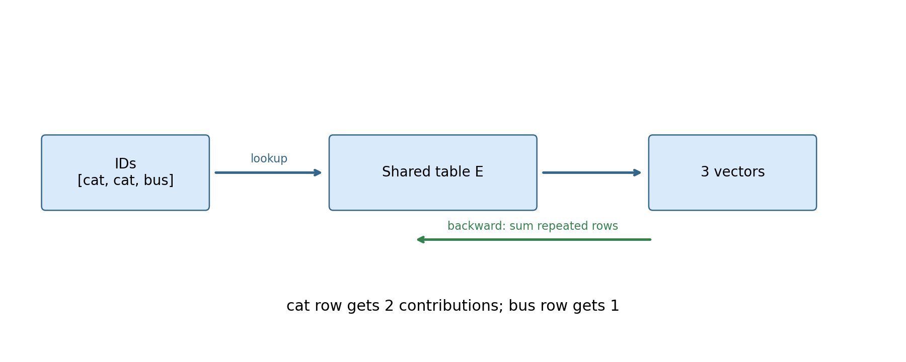
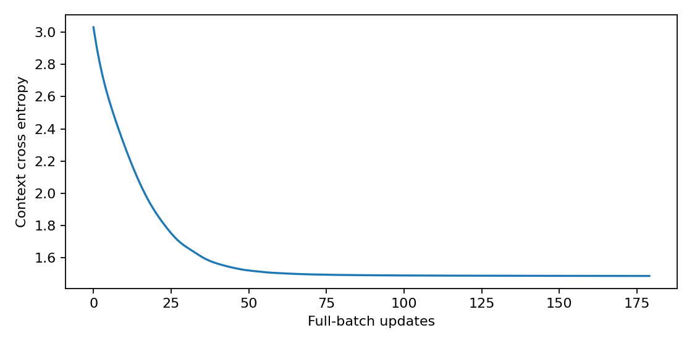
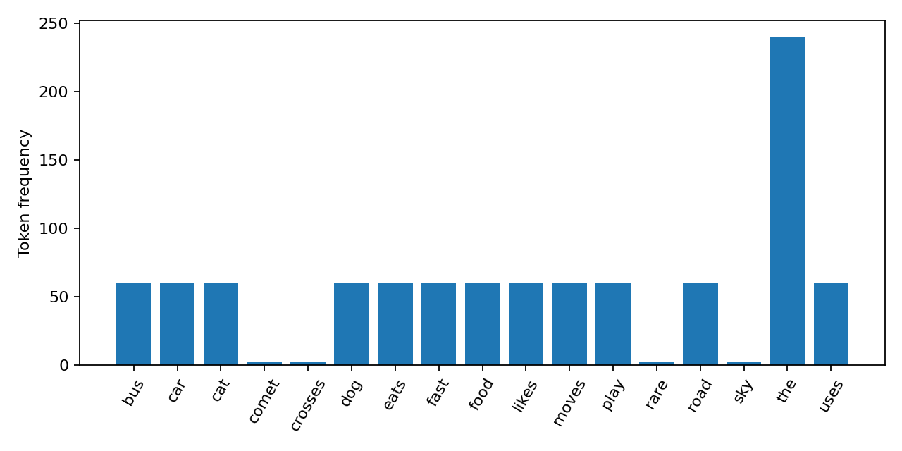

# 第096讲 离散表示与词嵌入

视觉之后，我们转向符号。像素强度具有数值大小，但词编号本身没有大小意义：“cat=3，dog=4”并不意味着狗比猫多1。本讲从one-hot出发，推导embedding查表与矩阵乘法等价，训练一个小型上下文预测模型，并检查共享词向量的梯度为何累加。

直接先修：009–010、020、043、083、086。你需要知道矩阵行列、概率归一化和梯度更新。实验语料由代码生成，没有个人信息、版权文本或下载的预训练权重。它是一种人工小语言，用于观察机制，不是现实语言能力评价。

核心原理：词ID是离散索引，嵌入矩阵的行是可学习参数。可微的是被选中的向量与后续计算，不是整数索引本身。

## 1 为什么不把词编号直接送进线性模型

设词表为[cat,dog,car,bus]，编号为0、1、2、3。如果把编号作为一个实数输入，线性模型会被迫认为dog到car的间距等于cat到dog，且bus的数值最大。换一个任意编号顺序，模型的几何关系就改变了，而词语意义没有改变。

正确思路是先把离散身份映射为参数向量。编号只负责“取哪一行”，不表达连续大小。词表排序仍应保存，因为同一权重矩阵配上不同词表会把向量赋给错误词，程序可能不报错，但模型含义已经变了。

## 2 One-hot是一张只有一个位置为1的身份证

词表大小为V，词i对应长度V的向量e_i，第i个分量为1，其余为0。不同词的one-hot内积为0，相同词为1。它保留身份但不编码语义相似度。

若V=4，dog编号1，其one-hot是(0,1,0,0)。设嵌入矩阵E有4行、3列，每行是一种词的3维向量。左乘e_i会只保留第i行：

$$e_i^T E=E_{i,:}.$$

因此查表并不是一种神秘的新运算，只是利用稀疏结构避免构造巨大one-hot。词表十万、一个batch上千个词时，显式one-hot非常浪费；查表只取需要的行。

## 3 用一个小矩阵手算查表

设E的四行分别是(1,0)、(0,2)、(−1,1)、(2,2)。输入词ID为[1,1,3]，输出依次是(0,2)、(0,2)、(2,2)。同一个词出现两次，取的是同一行参数的两次使用，不是创建两个独立向量。

把三个one-hot叠成矩阵X，形状3×4；XE得到3×2，与直接E[ids]完全一致。实验用浮点数组实际比较，两种前向最大差应为0。这个等价只涉及普通查表，不自动涵盖padding、max_norm或稀疏梯度等附加选项。

## 4 同一个词出现多次 梯度必须累加

设损失L等于查表输出所有元素之和。对一次输出的每个元素导数都是1。词1出现两次，因此E第1行每个分量收到2；词3出现一次，收到1；未出现的行收到0。

$$\frac{\partial L}{\partial E_{j,:}}=\sum_{t:i_t=j}\frac{\partial L}{\partial h_t}.$$

通俗解释是多次使用同一张参数卡片，所有使用位置提出的修改意见应汇总到同一张卡片。若写成逐次赋值而不是累加，最后一次会覆盖前面贡献。这个错误在向量化实现中尤其隐蔽。

本讲使用nn.Embedding并构造重复索引[cat,cat,bus]验证梯度，与bincount统计次数逐元素比较。测试不只检查前向形状，还检查共享参数的反向语义。下一讲循环网络时间反传也会遇到同一个参数在多个位置被重复使用。

## 5 贯穿案例 一份可以完全看清的人工语料

语料包括“the cat eats food”“the dog likes play”“the car uses road”“the bus moves fast”等模板，重复30轮；另加入两句“rare comet crosses sky”。动物和车辆分别共享某些上下文，因此模型可能把同类词放在相似区域。

这些模板故意让频率与共现结构清楚可见。高频词the出现在大量句子里，罕见词comet只有两次。若其近邻不稳定，这不神秘：它获得的训练约束少，而且只在一种上下文出现。人工语料中的相似不代表自然语言中的普遍相似。

所有句子在data/corpus.json，词表在data/vocabulary.json。词表只从本地训练语料构造。若以后引入测试文本，应预先定义未知词策略，而不是为了让测试词都能编码，把测试语料悄悄加入词表或训练目标。

## 6 从共现得到训练对

对每句中的中心词，取窗口半径2以内的其他词作为上下文。句子边缘的上下文比中间少。例如“the cat eats food”中，cat的上下文为the、eats、food；the的上下文为cat、eats。窗口不跨句子边界。

这会产生有方向的(center,context)词对。一次预测只使用中心词嵌入，不读取整句。这种简化具有重要限制：它不区分上下文词在左边还是右边，也不编码句子顺序。把“dog bites cat”和“cat bites dog”压成无序邻域，可能保留相似共现却丢失谁咬谁。

实际任务需要哪种上下文，就必须明确窗口、边界、采样和频率权重。把这些细节省略为“用了词向量”，会使结果无法复现。

## 7 用完整softmax预测上下文

输入嵌入E_i长度d=6。输出矩阵U有V行，每行u_j是一个上下文词的输出向量。对每个候选词j，分数为u_j^T E_i，softmax得到概率：

$$p(c=j\mid w=i)=\frac{\exp(u_j^T E_i)}{\sum_{k=1}^{V}\exp(u_k^T E_i)}.$$

对于真实上下文c，损失为−log p(c|i)，对全部训练词对取均值。实验使用全词表softmax，词表很小，计算便宜。它不是负采样word2vec实现；两者训练目标与归一化方式不同，不能混名。

模型有输入矩阵E和输出矩阵U，两套参数并不默认相同。训练一个词作为中心与训练它作为上下文会影响不同参数。近邻分析使用输入矩阵E，保存的embeddings.npz同时保留两套矩阵。

## 8 从softmax推到词向量梯度

对一个词对(i,c)，令p_j为预测概率，分数a_j=u_j^T E_i。交叉熵对分数的梯度是p_j−1[j=c]，再乘对E_i的导数u_j：

$$\nabla_{E_i}\ell=\sum_j p_j u_j-u_c.$$

直觉上，当前模型把概率质量放在哪些输出向量上，就产生它们的加权平均；真实上下文向量u_c把输入表示拉向能提高它相对分数的方向。若其他中心词也常预测同样上下文，它们的更新受到相似约束，于是可能形成相近表示。

这里没有直接写“猫必须靠近狗”的标签。相似来自共享预测任务。但嵌入几何不是唯一：对可逆矩阵A，将E变为EA并相应变换U，可以保持所有内积而改变输入向量欧氏几何。目标等价不保证每一种近邻度量都不变。

## 9 共享权重与不同位置共享不是同一件事

本讲的embedding查表天然使同一个词在不同位置共享E中的一行。另一种“权重共享”是把语言模型输出分类矩阵与输入嵌入矩阵绑定，即U=E。这样减少参数，并使输入与输出表示使用同一组坐标，但需要维度相容，且训练目标的梯度会共同作用于同一参数。

当前实验不做输入输出绑定。理解这个区别很重要：看到同一词重复使用一个向量，并不意味着模型输入和输出两套矩阵已经绑定。两种共享的作用位置和参数计数不同。

## 10 近邻究竟是什么证据

训练后将每个输入向量归一化，以余弦相似度找前三个近邻，排除词自己。cat和dog在模板里具有相似上下文，所以可能互为近邻。comet的近邻主要反映这几句人工数据和有限训练约束。

近邻表不是事实数据库，也不是推理轨迹。“cat靠近dog”不能回答某只动物今天吃了什么，更不能证明模型掌握完整生物学概念。若要研究事实回答或推理，需要专门任务、独立数据与可核查评价。

损失不必下降到0。同一个中心词对应多个上下文，模型只见中心词，因此无法知道当前训练对到底选了哪个上下文。最优分布会反映条件频率，仍有不可消除的条件熵。强行追求0可能误解了任务本身。

图2解释了为什么罕见词与高频词不应被同等解读。词频不仅影响更新次数，也影响训练目标中的总体权重。实验没有使用频率下采样或负采样，避免把这些额外机制藏起来。

## 11 顺序信息在哪里丢失

词嵌入负责把每个离散符号变成向量，本身没有序列位置。如果把整句嵌入直接求平均，任何词序重排都得到同一结果。对于“猫追狗”和“狗追猫”，这会丢失关键语义。

为处理顺序，需要额外结构，例如位置编码、卷积、循环状态或注意力。下一讲从最朴素的循环状态开始：每读一个词，就把它与旧状态组合成新状态，再让损失沿时间回传。不要要求embedding查表独自解决整句理解。

频率高不等于重要，余弦相似不等于事实相同，词ID接近不等于语义接近。每种数值都有自己的生成与评价规则。

## 12 练习

1. 以第3节矩阵手算ID=[0,2,0]的查表结果和总和损失的梯度。
2. 词表V=20、嵌入d=6，输入与无偏置输出矩阵一共多少参数？绑定后多少？
3. 对“the cat eats food”列出半径2、以eats为中心的上下文词。
4. 为什么本实验不能把训练损失无法归零判定为代码错误？
5. 若更换词表顺序却不重排E，前向仍能运行，为何结果错误？
6. 设计一个例子证明词向量求平均无法区分词序，并说明需要补充哪类机制。

## 参考

[Mikolov等，Efficient Estimation of Word Representations in Vector Space](https://arxiv.org/abs/1301.3781)提供分布式词表示和上下文预测的原始背景；本讲采用完整softmax与人工语料，不声称复现其大规模结果。[PyTorch Embedding](https://docs.pytorch.org/docs/stable/generated/torch.nn.Embedding.html)用于核对查表与参数接口。
