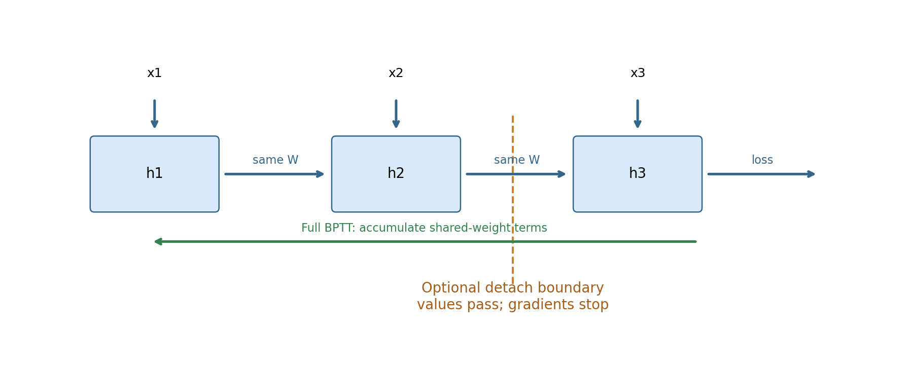
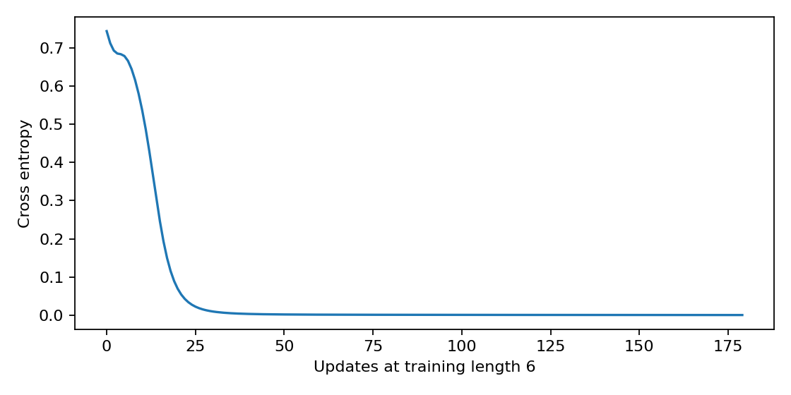
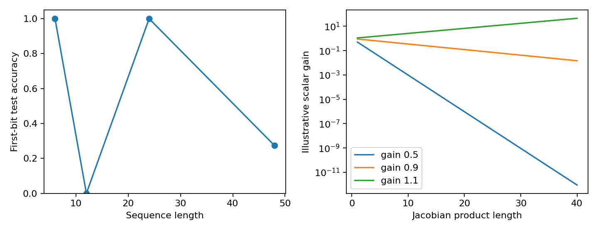

# 第097讲 循环网络与时间反传

第096讲把词ID变成向量，但每个词向量本身不包含已经读过哪些词。本讲加入一个随时间更新的隐藏状态，推导循环神经网络的前向递推与时间反向传播，并实际检查共享权重梯度、截断梯度、状态重置和长度外推。

直接先修：014、083、085–087、096。我们先用只有一个隐藏数值的RNN手算，再实现8维状态的CPU序列分类器。所有序列由本地生成器产生，不下载语料或模型。目标是理解循环机制与边界，而不是证明RNN已经具有长程推理能力。

核心原理：RNN在不同时间重复使用同一组参数。展开后看似多层，参数仍共享；反向传播要把所有时间位置对共享参数的贡献相加。

## 1 贯穿任务 记住第一个符号

每条序列第一个输入为−1或+1，分别对应类别0或1；之后输入是标准差0.12的小噪声。训练长度固定为6。模型直到读完最后一个位置才输出类别，所以必须把首位信息经过多次状态更新保留下来。

训练有128条序列，测试各长度256条，标签平衡。评价长度为6、12、24和48。测试长度变化时不仅多了步骤，也多了随机噪声输入，因此它同时检验状态动力学与干扰累积下的泛化。这个人工任务没有语言句法、真实长文结构或世界知识。

## 2 一个状态怎样不断更新

令x_t为第t个输入，h_t为隐藏状态。最简单的RNN是：

$$a_t=U x_t+W h_{t-1}+b,\qquad h_t=\tanh(a_t).$$

U把当前输入映射到状态空间，W把上一状态映射到新状态空间，b是偏置。起始状态h_0通常为零。最后用Vh_T+c产生类别分数。实验的输入维数1、隐藏维数8，因此U形状8×1，W形状8×8，b长度8，输出V形状2×8。

通俗地说，h像一张不断改写的便签。新输入与旧便签共同决定下一张便签。容量有限、更新非线性，而且没有规定便签的某个位置专门存首位符号。训练要通过最终错误学出一种可用编码。

## 3 时间展开让循环变成普通计算图

把长度3的序列画开，就是x1和h0产生h1，x2和h1产生h2，x3和h2产生h3，再由h3产生损失。图中每一步看起来有一个U和W，但它们是同一参数的重复使用。

如果错误地为每个时间创建一份独立W，模型就不再是这里定义的时间共享RNN，参数量随长度增长，长度外推也失去自然定义。若只对最后一步W求导，则漏掉早期使用位置的贡献。

可以把展开图理解为“带共享参数的深前馈网络”，但时间顺序与状态传递仍是任务结构的一部分。更深的展开路径会带来与深网络相似的梯度传播问题。

## 4 先手算一个标量RNN

令u=0.7，w=0.5，h0=0，输入为[0.2,−0.1,0.4]，状态更新h_t=tanh(u x_t+w h_{t−1})，损失L=h3²/2。

第一步a1=0.14，h1≈0.139092；第二步a2=−0.07+0.5h1≈−0.000454，h2≈−0.000454；第三步a3=0.28+0.5h2≈0.279773，h3≈0.272695。小数仅用于理解，代码保留float64计算精度。

为什么第二步几乎为零？输入负项与旧状态正项恰好接近抵消。这提醒我们，“状态中曾经有信息”不保证后面仍能保留。递推每一步都可能放大、衰减或翻转先前信号。

## 5 时间反传从最后一步开始

定义δ_t=∂L/∂a_t。对只在最后状态计算的标量损失，有δ_T=h_T(1−h_T²)。更早一步通过下一状态回传：

$$\delta_t=(W^\top\delta_{t+1})\odot(1-h_t\odot h_t),\qquad t<T.$$

若每个时间都有独立损失，还要把当前时间的直接梯度加进去；上式只对应本讲末端损失设置。不能把省略的直接项套到所有序列训练任务。

共享参数梯度是时间贡献之和：

$$\nabla_W L=\sum_{t=1}^{T}\delta_t h_{t-1}^\top,\qquad \nabla_U L=\sum_{t=1}^{T}\delta_t x_t^\top,\qquad \nabla_b L=\sum_{t=1}^{T}\delta_t.$$

第t步W乘的是h_{t−1}，所以外积也使用h_{t−1}，不是h_t。这个下标错误很常见。h0=0时第一步对W的直接贡献为0，但第一步仍影响后续状态，从而影响后面各项。

## 6 手写反传与两种独立检查

代码scalar_bptt保存所有h，先令对h_T的伴随梯度为h_T，然后倒序计算da=adj×(1−h_t²)，累加dw+=da×h_{t−1}，最后令adj=da×w继续向前一时间传播。

我们用中心有限差分估计共享标量w的梯度，再用PyTorch构造相同标量递推并自动微分。三者应在小误差范围内一致。这分别检查手写链式法则、实际函数扰动和框架计算图。它们一致只能验证这段小函数，不代表所有数据处理与长序列训练都正确。

## 7 梯度为何可能消失或爆炸

状态对旧状态的雅可比为J_t=D_t W，其中D_t为tanh导数构成的对角矩阵。跨越多步的梯度包含多个雅可比的乘积：

$$\frac{\partial h_T}{\partial h_t}=J_TJ_{T-1}\cdots J_{t+1}.$$

若沿某方向每步都近似乘0.5，十步后只剩约0.000977；若每步乘1.1，四十步约45.26。这里是帮助理解的标量增益例，不是实验模型真实雅可比谱的测量。真实矩阵的方向会变化，tanh还会饱和，不能只看W的一个数就决定所有轨迹行为。

梯度消失指训练误差信号难以传回过去；状态遗忘指前向信息难以从当前状态读出。二者相关但不等同。某个模型在长序列准确率差，可能因为状态振荡、分布变化、干扰或读出方式，而不能直接证明训练时梯度消失。

## 8 截断时间反传保留什么 丢掉什么

完整BPTT保留整条序列的计算图，内存通常随长度增长。截断BPTT每隔K步把状态detach，再继续前向。detach不改变状态数值，却切断状态与更早计算图之间的梯度连接。

本实验K=2。同一模型与输入在完整和截断模式下输出完全一致，但共享W的梯度不同。这不是数值误差，而是目标梯度估计方式改变。对于仅在最后一步产生损失的本例，早期片段不会通过被切断的状态收到末端误差信号。

截断并不等于“模型最多只能记K步”。前向状态仍可能携带更久的信息；但当前梯度无法沿被切断的路径训练那段长期依赖。不要把前向记忆范围与反向信用分配范围混为一谈。

如果每个片段都计算损失并更新参数，还要清楚说明损失归一化、更新时机和状态是否在参数变化后延续。本讲仅验证一次前向与梯度的截断差异，没有宣称训练出完整的截断BPTT流水线。

## 9 独立序列必须重置隐藏状态

一个batch里的每行是一条独立序列，默认h0全零。若把上一批的末状态直接送给下一批，下一批预测就依赖无关序列。测试结果会随样本顺序改变，甚至把训练信息带进测试。

实验先用零状态预测16条测试序列，再把16条训练序列的末状态作为初始状态重新预测，记录两组logit的最大差。非零差说明状态共享确实改变了函数。它不是一种合法默认增益，而是需要明确任务语义的状态输入。

连续流数据可以有意跨片段传状态，但必须保持流身份与时间顺序，在新流开始时重置，在不允许梯度跨边界时detach。不能因为“RNN有记忆”就任意让患者A的状态进入患者B，或让文档A影响独立文档B。

## 10 长度外推的真实结果没有义务单调

本次模型训练长度6后，在长度6准确率100%，长度12为0%，长度24为100%，长度48为27.34375%。这不是一条平滑下降曲线。长度12接近系统性预测反转，长度24又恢复，提示状态动力学与读出对长度高度敏感。

本次观察：同分布训练长度成功，不保证长度外推。非单调结果应完整报告；它不能单独证明某一种梯度失效机制。

如何进一步诊断？保存不同时间状态、检查正负首位在状态空间的轨迹、比较长度奇偶或周期、计算局部雅可比并增加多个训练种子。这些都属于新实验，不能在未做时写成已经确定的解释。本讲只把“可能存在长度相关翻转”作为待检验假设。

图2左右证据性质不同：左侧来自训练模型与独立测试序列，右侧只是0.5、0.9、1.1的幂。不能用右图代替实际梯度测量，也不能据此给左图现象定因。

## 11 从最小RNN走向下一讲

普通tanh RNN把记忆保留、信息写入和非线性变换混在一次递推里。下一讲门控结构会显式控制保留与更新，但门控不保证无限记忆，也不免除状态重置、数据隔离和评价设计。先掌握本讲的共享梯度与状态语义，才容易判断复杂门控实现是否正确。

参数量也可手算：输入层8个权重加8个偏置，循环矩阵64个权重，输出16个权重加2个偏置，总计98个。长度变长不会增加参数个数，但增加计算步骤、激活存储和误差传播路径。

## 12 练习

1. 手算u=1、w=0、输入[1,0]时h1、h2和末端平方损失；解释为何第一步信息消失。
2. 推导标量共享w的两步梯度，指出两个时间位置分别贡献什么。
3. 用0.9的连乘估算20步后的增益；为什么它不等于模型准确率？
4. 为什么detach后前向不变而梯度变化？末端损失能否跨越被切断边界？
5. 给出两个应重置状态的场景和一个允许连续传状态的场景。
6. 按第10节真实结果写两句报告，分别说明观察和未确定机制，不能写成单调遗忘。

## 参考

[Pascanu等，On the difficulty of training Recurrent Neural Networks](https://arxiv.org/abs/1211.5063)讨论RNN训练中的梯度传播问题。[PyTorch RNN](https://docs.pytorch.org/docs/stable/generated/torch.nn.RNN.html)用于核对标准递推与形状约定。本讲使用显式手写循环而非封装RNN层，以便直接查看状态初始化与detach位置。
