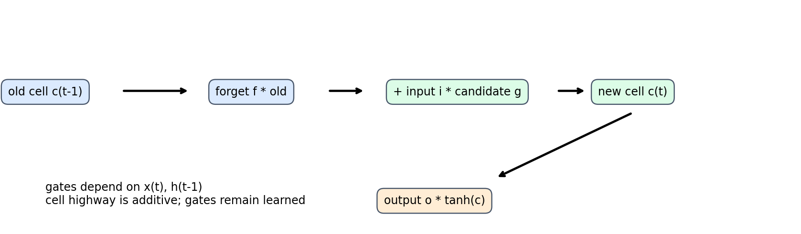
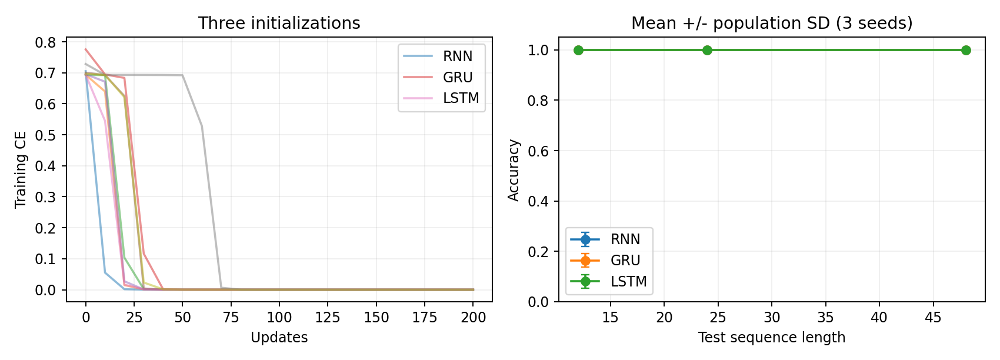

# 第098讲 门控记忆与序列任务

第097讲的循环网络把过去压进一个状态，再反复用非线性函数改写。它可以学习记忆，也可能在许多次更新中把早期信号冲淡。本讲不把“换成LSTM”当魔法，而是逐项看门控如何改变更新路径，如何正确处理长短不一的序列，以及哪些测试才能发现未来泄漏和padding错误。

直接先修：050、086–087、097。学习目标是读懂LSTM和GRU每个门的作用，手算一次更新，区分状态记忆与梯度传播，并独立完成延迟依赖与有效token损失测试。

核心问题：记忆系统需要分别决定保留什么、写入什么、暴露什么。门是由输入和旧状态算出的连续数值，不是人为填写的“记住/忘记”标签。

## 1 贯穿任务 为什么要等到最后才作答

假设一个传感器最初发送−1或+1，随后只有小幅随机干扰。接收器读完整段消息后才回答最初符号是什么。训练序列长度为12，测试长度为12、24、48。信号只出现在首位，读出只在末尾，因此模型不能靠最后一个输入取巧。

训练集192条，测试每种长度256条，标签严格平衡，独立生成。后续噪声标准差0.10。模型为单层RNN、GRU、LSTM，隐藏宽度均12，后接2分类线性层。每种结构以种子0、1、2各训练一次，Adam学习率0.02，共200次全批量更新，梯度范数裁剪上限1。训练集在所有模型和种子间固定，变化的是初始化，不是新抽三份数据。

为什么同时看训练和外推？训练长度准确率高只能说明模型能完成见过的时间跨度；长度48加入了更多递推与干扰，属于分布变化。若外推下降，不应立即断言“门没用”，也不能仅凭一个成功种子说“解决了长程依赖”。

## 2 从普通RNN的反复改写出发

普通RNN的核心是h_t=tanh(Wx_t+Uh_{t−1}+b)。每一步把旧状态与当前输入混合后重新通过tanh。旧信息没有独立的保存通道。跨时间梯度要乘很多雅可比，容易在某些方向衰减或增长。

一种设计思路是保留一条加法通路：新记忆等于“留下的旧记忆”加上“选择写入的新内容”。加法本身对每个加数的导数为1，所以它可以减少反复非线性变换造成的障碍；但通路前面的门仍然可能关闭，因此不能保证无限记忆。

## 3 先理解门的数值 而不是名字

sigmoid把任意实数映射到0与1之间。门值0.95表示这个坐标大部分通过，0.05表示大部分抑制。它不是概率事件的一次随机抽样，也不是只能取0和1的硬开关。训练通过损失梯度调整产生门值的权重。

把输入x_t与旧隐藏状态h_{t−1}拼接为z_t。对每个隐藏坐标，LSTM计算遗忘门f、输入门i、候选内容g、输出门o：

$$f_t=\sigma(W_fz_t+b_f),\quad i_t=\sigma(W_iz_t+b_i),\quad g_t=\tanh(W_gz_t+b_g),\quad o_t=\sigma(W_oz_t+b_o).$$

四个名字对应四组参数。g可正可负，负责“写什么”；i非负且不超过1，负责“写多少”。把g也称为概率会误导，因为负值在记忆表示中完全合法。

## 4 LSTM为何同时有c与h

细胞状态c是内部记忆，隐藏状态h是当前对外暴露的表示。更新为：

$$c_t=f_t\odot c_{t-1}+i_t\odot g_t,\qquad h_t=o_t\odot\tanh(c_t).$$

符号⊙是逐坐标相乘。c_t可以累积到绝对值大于1，h_t经过tanh和输出门后每个坐标在−1到1之间。后面的分类头读取h，而门也通过h依赖过去。不要把c和h当成可以随意互换的变量。

门控并不要求每个坐标对应可读的人类概念。本任务某个坐标可能参与保留符号，但通常许多坐标联合编码。仅展示一个门轨迹不足以证明一个坐标“代表肯定”或“代表否定”。

## 5 手算一格记忆的变化

假定旧记忆c_old=0.8，遗忘门f=0.9，输入门i=0.2，候选g=−0.5，输出门o=0.7。保留项为0.72，写入项为−0.10，新记忆为0.62。tanh(0.62)约0.5511，因此h约0.3858。

这个例子说明写入并非总让记忆“更多”：新内容可以抵消旧内容。若输入门为0、遗忘门为1，则c恰好原样复制；若f为0、i为1，则旧内容被完全替换。真实sigmoid在有限输入下不会精确达到0或1，这两种情形是解释机制的理想极限。

现在令每一步f固定为0.9且没有写入，50步后旧记忆贡献只剩0.9^50≈0.005154。若f=0.99，则剩0.605006。接近1的门能显著延长保留，但“接近”与“等于”差异会被长时间累积放大。

常见误区：LSTM有加法通路，所以梯度永不消失。正确理解是它提供较容易学习的保留路径；门值、饱和、其他依赖路径、优化和有限状态容量仍会限制记忆。

## 6 梯度中的直接路径和全部路径

把其他依赖暂时固定，c_t对c_{t−1}的直接偏导是diag(f_t)。沿这条直接细胞通路传播多步时，各坐标乘上对应遗忘门的乘积。这个表达揭示为何接近1的f有帮助。

但完整计算图中，c_{t−1}还影响h_{t−1}，h_{t−1}又影响所有门。完整总导数必须包括这些间接路径。教材中常写的“梯度就是遗忘门连乘”通常只指直接通路分析，不能冒充一般情况下完整雅可比的精确等式。

本讲验证单步LSTM手写公式与nn.LSTMCell一致。框架把四组仿射运算打包为一次矩阵乘法；PyTorch门排列为i、f、g、o。若按f、i、o、g去切块，形状仍正确、程序也能跑，但语义已经错了。单步数值对齐比仅观察训练下降更能定位这种错误。

## 7 GRU如何把结构简化

GRU通常只保留一个隐藏状态。以本实验PyTorch约定为准，重置门r、更新门z、候选n为：

$$r=\sigma(W_{ir}x+b_{ir}+W_{hr}h+b_{hr}),\quad z=\sigma(W_{iz}x+b_{iz}+W_{hz}h+b_{hz}).$$

$$n=\tanh(W_{in}x+b_{in}+r\odot(W_{hn}h+b_{hn})),\qquad h'=(1-z)\odot n+z\odot h.$$

此约定中z大表示保留旧状态多。某些文献使用相反命名，让z大表示写入多；不能只凭符号名称判断实现。PyTorch还把重置门乘在隐藏线性变换之后；这与先把r乘到h上再做矩阵乘法一般不等价，因为矩阵会混合坐标。

GRU没有独立的c与输出门，参数往往较少，结构更紧凑。它不天然比LSTM强或弱。任务、参数预算、训练方法和数据量不同，结果都可能改变。

## 8 公平比较到底公平在哪

输入维度I、隐藏维度H时，PyTorch单层单向RNN核心参数量为HI+H²+2H；GRU为其3倍；LSTM为其4倍。两个偏置来自输入变换与隐藏变换各一份。分类头另有2H+2个参数。

本实验I=1、H=12，核心基数为180，总参数RNN为206、GRU为566、LSTM为746。相同隐藏宽度不等于相同参数量，相同更新次数不等于相同FLOPs或墙钟时间。因此本实验回答的是“在相同状态宽度、数据和优化次数下，三种结构怎样表现”，不是参数预算完全匹配的架构竞赛。

若想更严谨，可以补充匹配参数量的不同宽度，报告运行时间，再扫描学习率。三种种子只能展示初始化敏感性，误差条用总体标准差，不是置信区间；训练数据固定，所以不能解释为数据采样不确定性。

## 9 padding为什么不应该成为真实时间

为了把长度不同的序列放进同一张量，常把短序列补到同一长度。例如有效长度为[2,4]，张量形状是[2,4,特征数]。第一个样本后两个位置只是占位符。

即使padding输入为0，循环状态仍会经历隐藏权重和偏置更新，所以取统一最后位置out[:,−1]一般是错的。本讲按每个样本的length−1索引最后有效状态。对于单向网络，后面新增的padding不会反过来影响较早输出，因此这种读出可以严格保持有效结果不变。

更高效的方式是打包变长序列，让框架跳过无效时间。使用pack_padded_sequence时要按API要求处理length和排序。无论选哪条路线，都要写“追加任意padding后有效输出不变”的测试，而不是仅检查张量能相乘。

## 10 有效token损失该怎样平均

逐token任务的损失l_bt先不约简，令m_bt在有效位置为1、padding为0：

$$L=\frac{\sum_{b,t}m_{bt}l_{bt}}{\sum_{b,t}m_{bt}}.$$

分母是有效token数，不是batch×最大长度。否则同一批有效内容只因多补几格，损失就变小，梯度尺度也随padding比例变化。若分母为0，应明确报错或由上游跳过；悄悄除以1会掩盖空批次问题。

实验追加3列随机logits和无效标签，mask均为0，验证有效损失完全不变。这个测试与状态读出测试不同：损失mask处理正确，不代表循环状态读出正确；反过来也一样。训练主任务是末端分类，逐token损失是单独的机制验证，不能把二者混称为同一训练目标。

## 11 双向网络与未来泄漏

双向网络分别从左往右、从右往左处理序列，再拼接两个表示。在整段已知的文本标注、离线语音处理等任务中，利用两侧上下文可以合理。在预测下一时刻、在线告警和自回归生成中，右侧未来通常尚不可见。

如果在位置t预测未来标签，却让反向状态读取t之后的真实输入，离线成绩会虚高。正确审计问题不是“有没有使用LSTM”，而是“每个预测在真实部署时允许看到哪些信息”。本讲所有训练网络都是单向，避免把未来输入用于当前预测。

双向变长网络还有额外padding陷阱：反向分支会先读padding，再到有效token。仅选择length−1并不能自动修复反向污染，通常需要打包或正确分段。单向追加padding不变的结论不可无条件推广到双向。

## 12 读取真实实验结果

数值表在outputs/evaluation.csv，训练曲线在outputs/curves.csv，所有生成数组在data/sequences.npz。outputs/results.json还记录单步对齐、mask损失、正确读出和错误末端读出的差异。请先打开这些文件，再对照答案中的实测摘要。

解释顺序应是：先确认训练任务是否学会，再看同长度测试，再看长度外推；对差异查参数量与种子；最后才提出结构假说。某次准确率为1意味着这256条合成测试全部答对，不意味着任何长度、任何噪声或真实语言都能答对。

## 13 自查与继续探索

能否不看代码解释c与h区别？能否说明GRU更新门约定？能否写出有效token分母？能否用一个反例区分“损失mask正确”与“状态padding处理正确”？若这些问题回答不清，先完成lab中的手算和破坏性测试。

后续第099讲将不再要求所有历史都塞进同一个状态，而是通过注意力按当前问题读取不同历史位置。注意力也有mask、复杂度与信息边界，不是把门控网络所有困难自动消除。

## 参考与复现范围

LSTM原始论文：[Long Short-Term Memory](https://www.bioinf.jku.at/publications/older/2604.pdf)。框架公式与门顺序：[PyTorch LSTM](https://docs.pytorch.org/docs/stable/generated/torch.nn.LSTM.html)；GRU实现约定：[PyTorch GRU](https://docs.pytorch.org/docs/stable/generated/torch.nn.GRU.html)。本文机制解释为独立教学推导，实验是本地合成数据的CPU验证，不使用外部模型或服务。
