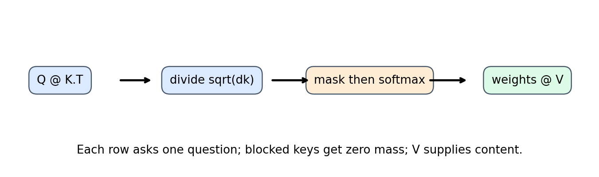
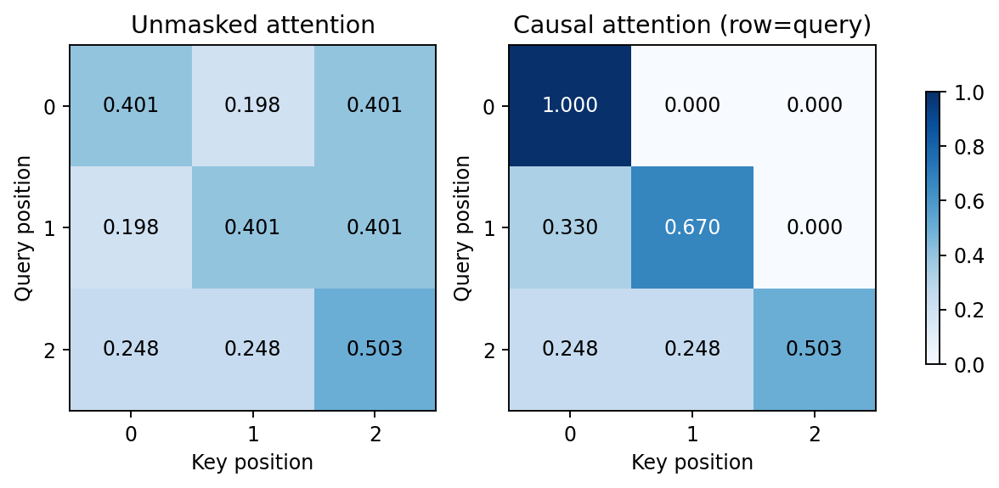

# 第099讲 注意力的完整计算

第098讲用一个随时间更新的状态保存历史。若问题变化，希望读取的历史位置也会变化：回答“谁拿了钥匙”与“钥匙放在哪里”需要关注的内容不同。本讲把这种按问题检索的想法拆成可手算、可求导、可核验的矩阵运算。

直接先修：009–010、014、043、086、096。我们从三个token的二维例子开始，完整计算分数、权重、输出，再实现多批次多头张量运算，推导梯度并测试信息边界。实验不训练语言模型，不把注意力热图当解释真相。

注意力做两件事：用Q和K决定“读哪里”，用权重对V做加权汇总。高权重表示当前计算中该值向量权重大，不自动表示对应词是预测的因果原因。

## 1 把检索问题变成三个对象

query，简称Q，是当前要问的问题表示；key，简称K，是每条可检索内容的索引表示；value，简称V，是实际取回并汇总的内容表示。图书馆类比中，Q像检索条件，K像书目标签，V像书本内容。这只是理解角色，不意味着模型内部向量可以逐维翻译成人话。

自注意力中Q、K、V都由同一序列X经过不同线性映射得到；交叉注意力中Q来自一段序列，K和V来自另一段。来源相同不等于数值相同，因为投影矩阵通常不同。不能把“自注意力”误读为每个位置只能看自己。

## 2 先把形状写清楚

单头下，Q形状为L_q×d_k，K为L_k×d_k，V为L_k×d_v。QK转置得到L_q×L_k，每一行对应一个查询，每一列对应一个候选键。最后输出为L_q×d_v。

K和V必须有相同的候选位置数L_k，Q与K必须有相同的特征维度d_k；Q位置数与K位置数可以不同。交叉注意力例如5个查询读7个候选，权重形状5×7，输出仍然有5个查询位置。

带批次B与头数H时，本讲采用[B,H,L,d]。矩阵乘法只对最后两维运算，前两维表示彼此独立的批次与头。出现不合预期的广播时，程序可能仍能运行，所以必须同时检查形状和语义。

## 3 点积为什么要缩放

分数矩阵S定义为：

$$S=\frac{QK^\top}{\sqrt{d_k}}.$$

点积把同方向分量累加。若q和k各坐标近似独立、均值0、方差1，则它们乘积的方差约1，d_k项相加的方差约d_k。除以sqrt(d_k)把典型波动尺度保持在较稳定范围，避免维度变大时分数普遍变大，使softmax过于尖锐。

这是基于假设的动机，不是所有训练向量都服从标准正态的断言。模型仍可通过投影权重改变分数尺度，缩放也不能保证梯度永远良好。把除数写成d_k会比设计中的缩放更强，不能因为形状不变就视为等价。

## 4 一行softmax究竟归一化什么

对查询i的所有可读候选j，权重为：

$$A_{ij}=\frac{\exp(S_{ij})}{\sum_r\exp(S_{ir})},\qquad O=AV.$$

softmax沿最后一维，即键位置维度。每行权重非负、和为1。为数值稳定，实际计算先减去该行最大值；分子分母同时乘同一因子，结果不变。若错误地对查询维度归一化，每列和为1，语义就变成候选在不同查询间分配，而非每个查询选取候选。

O_i是值向量的凸组合。若没有后续投影且权重由普通softmax产生，输出落在这一组值向量的凸包中。但整个Transformer还有多头拼接、输出投影、残差和前馈层，不能据此说整个模型只能产生输入值的简单平均。

## 5 手算三个token

本讲固定Q=K=[(1,0),(0,1),(1,1)]，V=[(10,0),(0,20),(5,5)]。这里值向量故意不同于键向量，帮助分清匹配信息与取回内容。

第一行未缩放点积为[1,0,1]，缩放后为[0.707107,0,0.707107]。取指数约[2.028115,1,2.028115]，总和约5.056230，因此权重约[0.401112,0.197776,0.401112]。

输出第一坐标为0.401112×10+0.197776×0+0.401112×5≈6.016681；第二坐标为0.401112×0+0.197776×20+0.401112×5≈5.961077。每个查询都有自己的一行分数与输出，不能用同一行权重套到所有token。

第三个查询与前两个键的点积都是1，与第三个键的点积是2，因此第三个候选会获得更高权重。这不是模型“理解了第三个词重要”，只是我们指定向量后的确定性计算。

## 6 因果mask应该屏蔽哪半边

自回归位置i只能读取j≤i的键。若矩阵行是查询、列是键，那么允许区域是下三角（包括对角线）。把不允许位置的分数置为负无穷，再做softmax，它们权重就为0。

因果mask下，第一个查询只看第一个值，所以输出精确为(10,0)。第二个查询可看前两个键，第三个查询可看全部。上三角还是下三角取决于行列定义，不能死记一个三角名字而不画具体信息流。

API的布尔含义不统一。本讲attention和PyTorch scaled_dot_product_attention中True表示允许读取；某些MultiheadAttention或Transformer接口中True表示屏蔽。复制mask前先查接口语义，不能只看变量叫mask。

## 7 padding mask与因果mask不是一回事

因果mask表达时间信息边界，padding mask表达哪些候选根本不是数据。两者通常用逻辑与组合为allowed。若一个序列有效长度2，后面第3、4列都是padding，那么所有有效查询都不应读这些列。

屏蔽无效键还不够处理无效查询：padding查询仍可能产生输出，只是这些输出不应进入有效token损失或后续有效统计。若把某一整行都屏蔽，softmax对全负无穷会产生未定义归一化；本讲选择显式拒绝，要求每个参与计算的查询至少有一个可读键。

实验追加两列随机K/V，并把新增列标成不可读，检查输出不变。随机padding比全零更有鉴别力，因为错误读取全零有时只轻微改变结果，容易被宽松阈值掩盖。

## 8 为什么屏蔽要在softmax之前

假定原权重为[0.4,0.2,0.4]，要禁止第三个位置。若softmax后直接把它置零，剩余和变成0.6，输出被无意缩小。正确做法是在分数阶段屏蔽，再对允许项归一化，或者明确对剩余权重重新归一化。

屏蔽前置还有更清晰的梯度语义：不允许的分数不参与归一化，也不向被屏蔽键传播这一查询的梯度。实际实现使用masked_fill加负无穷，避免给“很大的负数”选择与数据尺度不匹配的常量。

## 9 从输出开始推梯度

设上游梯度G=∂L/∂O。因为O=AV，有：

$$\frac{\partial L}{\partial V}=A^\top G,\qquad \frac{\partial L}{\partial A}=GV^\top.$$

第一式把各查询对同一个值向量的需求汇总起来；第二式问如果提高某条读取权重，会怎样改变当前损失。权重不是固定解释标签，它本身也被训练目标调整。

对单行softmax，雅可比为diag(a)−aa转置。若该行收到上游梯度u，则分数梯度可以不构造大雅可比而计算：

$$\frac{\partial L}{\partial S_i}=A_i\odot\left(U_i-\sum_j A_{ij}U_{ij}\right).$$

括号中的加权平均使该行分数梯度和为0：给所有分数同时加同一常数不改变softmax，所以沿该方向不应改变损失。这是可用于检查推导的一条不变性。

## 10 再把梯度送回Q与K

因为S=QK转置/sqrt(d_k)，有：

$$\frac{\partial L}{\partial Q}=\frac{(\partial L/\partial S)K}{\sqrt{d_k}},\qquad \frac{\partial L}{\partial K}=\frac{(\partial L/\partial S)^\top Q}{\sqrt{d_k}}.$$

Q梯度汇总所有候选对当前问题匹配的影响；K梯度汇总所有查询对同一候选索引的影响。若Q=XW_Q、K=XW_K、V=XW_V来自同一X，X的梯度还要把三个投影分支贡献相加。只回传V分支会漏掉“学会如何读取”的部分。

本讲backward函数独立实现上述三式，与自动微分的Q/K/V梯度比较，还对Q的一个坐标做中心有限差分。手写梯度、框架梯度和实际函数扰动属于不同检查路径，联合验证比只比较前向更强。

## 11 多头是多套读取视角

模型维度d_model分成H个头，每头d_k通常为d_model/H。先投影Q/K/V，再把[B,L,d_model]变形成[B,H,L,d_k]。各头独立算注意力，最后把头维与每头特征维拼回，再乘输出投影W_O。

多头不是把序列位置切成H段；每个头通常都能读取完整允许上下文。头之间独立的是注意力计算，前后的线性投影可以混合特征。若transpose后直接view导致存储布局不兼容，应使用reshape或先contiguous，而不是删掉转置凑形状。

本实验随机验证张量[B=2,H=2,L=4,d_k=3,d_v=2]，支持每头值维不同于键维。它验证注意力核心，完整投影与残差块将在第100讲实现。

## 12 时间和内存为什么随长度平方增长

计算QK转置需要约L_qL_kd_k次乘加量级，计算AV需要L_qL_kd_v量级。普通实现显式保存每头L_q×L_k分数和权重；自注意力L_q=L_k=L时为O(HL²)元素。

当H=4、L=128，仅一张float32分数张量就有65536个元素、262144字节。它不是完整训练峰值内存，还没加权重、中间激活、参数、梯度、优化器状态和实现工作区。长度翻倍使这张分数张量元素数变四倍，不等于整次训练耗时必然精确四倍。

优化内核可以不把完整权重矩阵长期写入显存，从而显著改善内存与速度，但数学交互仍涉及所有允许位置对。区分数学公式、朴素张量实现和高性能内核，避免把一个复杂度描述套到所有实现细节。

## 13 什么证据才能证明没有偷看未来

让未来K/V发生大幅变化，保持当前和过去Q/K/V不变，检查早期输出是否不变。实验修改位置3的K/V，检查位置0–2；正确因果mask输出不变，去掉mask则明显变化。这个对照比“训练loss看起来正常”更直接。

注意本讲测试的是注意力核心的输入信息边界。完整系统里，如果Q本身已由双向预处理产生，或者标签错位，注意力mask正确仍可能泄漏。因此还要追踪Q/K/V的来源和标签定义。

## 14 热图能说什么 不能说什么

热图能展示当前数值运行的读取权重、mask形状和归一化情况。它不能单独证明因果重要性：值向量大小、输出投影、多头抵消、残差、后续网络都影响最终结果。某个位置权重小但值很大，也可能贡献显著。

若要讨论因果影响，需明确干预方式，例如替换或删除某个输入后测输出变化，并承认干预可能造成分布外输入。注意力权重与干预效应是不同量，相关不等于等同。

## 15 复现与参考

运行experiment.py生成三token数据、数值表和图；运行单测验证9项机制性质。outputs/results.json记录所有误差与反例，answers给出实测解读。固定随机种子99，CPU float64，dropout关闭。

原始机制参考：[Attention Is All You Need](https://arxiv.org/abs/1706.03762)。API的mask与dropout语义参考：[PyTorch scaled_dot_product_attention](https://docs.pytorch.org/docs/stable/generated/torch.nn.functional.scaled_dot_product_attention.html)。本讲推导与实例为独立教学内容，不以玩具实验复现原论文翻译成绩。
