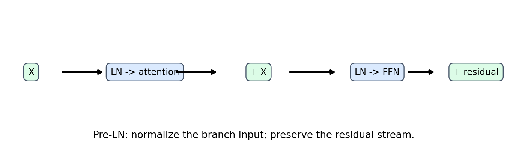
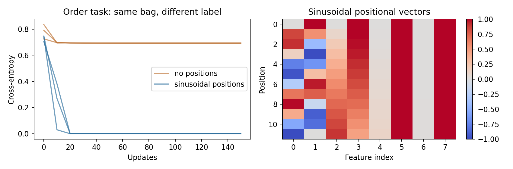

# 第100讲 Transformer块与位置

第099讲给出注意力的完整计算，但一层注意力并不是完整Transformer。模型还需要保留原表示、稳定特征尺度、对每个位置做非线性加工，并知道顺序。本讲从一个可逐项核验的小块出发，理解这些零件为什么存在，以及它们组合后保留和打破哪些对称性。

直接先修：083、085、089、096、099。目标是从零实现一个Pre-LN块，与框架对齐前向、输入梯度和全部参数梯度，再用顺序任务验证位置机制的必要性。模型宽度8、头数2、前馈宽度16，全部CPU运行，不调用预训练模型。

注意力负责跨位置读取，前馈层负责每个位置内部的非线性变换，残差保留可直达的表示路径，归一化稳定分支输入尺度。位置机制告诉网络内容位于哪里。

## 1 贯穿例子 两个词一样 顺序不同

我们把token 0叫A、token 1叫B。只有两种序列：[A,B]与[B,A]，标签分别为0和1。两个序列的词袋完全相同，只有顺序不同。模型读完整段后做平均池化，再分类。

这个任务故意极小：如果网络根本不具备区分置换的结构能力，增加训练步数也不应解决它。数据把两种模式各重复32次形成batch，总共64条；没有独立未见模式测试，因为所有可能模式已经枚举。它是可表示性和优化的诊断，不是泛化能力研究。

我们对比相同块、相同平均池化、相同训练预算，仅改变是否添加正弦位置向量。每组3个初始化，150次Adam更新，学习率0.02。结果应结合严格的置换等变性测试一起读，而不是只看训练准确率。

## 2 一个Pre-LN块的两条残差

令输入X形状[B,L,d]，一个Pre-LN块写成：

$$Y=X+\operatorname{MHA}(\operatorname{LN}_1(X)),\qquad Z=Y+\operatorname{FFN}(\operatorname{LN}_2(Y)).$$

LN表示LayerNorm，MHA表示多头自注意力，FFN表示前馈网络。本讲关闭dropout以便精确对齐。两个LN参数独立，两个残差各自把分支输入与分支输出相加。若错误地第二次仍加原始X，就不再是这个块。

残差要求分支输入输出的最后维度相同。注意力内部可以拆头，前馈内部可以扩宽，但回到主干时都必须是d。残差不是额外训练标签，也不是把损失加回输入。

## 3 残差为什么有助于深层训练

对y=x+f(x)，局部导数为I+J_f。梯度除了经过分支，还能沿恒等路径传回。若某层目前不需要大幅改变表示，可以学习较小的分支输出；它不必先学出一个复杂网络来近似恒等映射。

但I+J_f仍可能在某些方向放大或抵消，残差并不保证任意深网络稳定。初始化、归一化、学习率和深度都会影响训练。把“有直通路径”解释为“没有梯度问题”会过度概括。

残差也影响解释：某头的注意力输出很小，输入仍可以沿主干进入后续层；注意力热图不能代表整层所有信息来源。

## 4 LayerNorm归一化哪一组数

对每个样本每个位置，LN只沿最后的特征维度d求均值和方差：

$$\mu=\frac1d\sum_j x_j,\quad \nu=\frac1d\sum_j(x_j-\mu)^2,\quad \operatorname{LN}(x)_j=\gamma_j\frac{x_j-\mu}{\sqrt{\nu+\epsilon}}+\beta_j.$$

gamma与beta是每个特征可学习的缩放和平移。本讲框架默认epsilon为1e−5，方差分母是d，不是d−1。它不是对整个batch求统计的BatchNorm，因此一个样本的表示不需要依赖同批其他样本。

LN不会把不同token混在一起，也不会告诉模型位置。每个位置使用同一套gamma和beta，所以若只交换token，LN输出也只是跟着交换。这一点是后面置换等变性推导的基础。

## 5 Pre-LN与Post-LN不是随便换位置

Post-LN通常写为Y=LN(X+MHA(X))；Pre-LN写为Y=X+MHA(LN(X))。它们的计算图、参数输入分布与梯度路径不同。原始Transformer论文采用的布局与本讲选择的Pre-LN不能混称为逐项相同。

本讲选择Pre-LN方便看清未归一化主干的恒等残差路径，并与PyTorch norm_first=True对齐。完整Pre-LN模型常在最后再加一个LN；本讲只研究单块，没有把最终模型LN藏进块内。参考实现也必须关闭dropout、选择GELU、相同epsilon和norm_first，才是同一个函数。

## 6 多头投影怎样拼接

代码用一层Linear(d,3d)一次算出Q/K/V，这与三个独立Linear在数学上可等价，只是把权重按输出维度堆叠。切分后各为[B,L,d]，再变形为[B,H,L,d/H]。

本讲d=8、H=2，每头维4。注意力核心得到每头[B,H,L,4]，转置并reshape回[B,L,8]，然后通过输出投影Linear(8,8)。输出投影可以混合不同头的信息，不是固定把各头平均。

参考实现的in_proj_weight按Q、K、V顺序存放，必须把我们的qkv权重直接复制到对应位置。若只让随机种子相同，两种模块初始化的参数创建顺序未必相同，不能保证权重一致；所以数值对齐要显式复制全部参数。

## 7 前馈层为何不是“又一层注意力”

本讲FFN为：

$$\operatorname{FFN}(x)=W_2\operatorname{GELU}(W_1x+b_1)+b_2.$$

第一层从d=8扩到f=16，经过非线性，再投回d=8。相同FFN应用到每个位置，既不跨时间卷积，也不读取其他token。跨位置交互发生在注意力；FFN加工已经聚合到当前位置的表示。

若没有非线性，两层线性可以合并成一层，扩宽的表达意义大幅降低。GELU近似按输入大小平滑调节输出，既不同于硬阈值ReLU，也不应与sigmoid概率输出混淆。本实验使用框架精确GELU默认路径，确保参考一致。

## 8 为什么没有位置时只会跟着置换

令P是对序列位置重排的置换矩阵。没有位置向量和不对称mask时，Q、K、V都随X同样置换。分数变成P S P转置，逐行softmax仍相应置换，输出变成P O。

LN和FFN都是共享的逐位置函数，残差加法也保持位置对应，因此整个块满足F(PX)=P F(X)，称为置换等变。如果最终平均池化，mean(PF(X))=mean(F(X))，所以分类器对[A,B]和[B,A]给出相同结果。

“等变”不是输出完全不变，而是输出随输入重排；“不变”是池化后的全局结果不变。混淆二者会错误地说Transformer每个token输出都一样。实验分别测块输出等变误差和池化不变误差。

这个证明有条件：没有位置机制、没有破坏置换的mask、使用共享逐位置变换和对称池化。因果mask本身携带前后边界结构，不能把同一证明无条件套到所有无显式位置的causal模型。

## 9 正弦位置向量怎样构造

对位置p和频率索引i，经典正弦编码为：

$$\operatorname{PE}(p,2i)=\sin\left(p/10000^{2i/d}\right),\qquad \operatorname{PE}(p,2i+1)=\cos\left(p/10000^{2i/d}\right).$$

每两个特征是一组相同频率的sin/cos，低频分量随位置变化较慢，高频分量变化较快。位置0并非全零：sin部分为0，cos部分为1。代码要求d为偶数以便成对分配，这是本教学实现的限制，不是所有位置方法的必然限制。

把PE加到token embedding后，交换token内容但保留位置索引会改变“哪个内容与哪个位置组合”。因此网络可以区分[A,B]和[B,A]。如果把内容和对应位置向量一起搬走，则只是重排已经带位置的向量，等变性仍成立；实验必须固定位置再交换内容。

## 10 能算更长位置不等于可靠外推

正弦公式可以为训练范围之外的位置生成数值，这不等于模型学会处理更长依赖。注意力交互数、内容分布、模式频率和优化经验都可能改变。学习式绝对位置表则还受表长度限制，超出范围需另行处理。

相对位置、旋转位置等方法改变位置进入注意力的方式，本讲只建立绝对正弦编码的基线，不把方法名字罗列当机制掌握。下一步学习其他方法时，应问它改变分数、值还是输入表示，保留什么相对关系，并设计可验证的不变性测试。

## 11 Encoder、causal decoder与交叉注意力

Encoder自注意力通常允许读取整段有效输入，适合已知整段的表示学习。Causal decoder的自注意力限制为过去与当前，用来按位置预测后续token。Encoder-decoder结构的decoder还可通过交叉注意力读取编码后的源序列。

本讲Block默认不加mask，表现为双向自注意力块；传入下三角allowed后，可验证因果信息边界。它没有交叉注意力子层，因此不是完整翻译decoder，也不包含词表输出头或语言建模标签。不要看到类名Transformer就默认具备所有这些组件。

PyTorch参考层src_mask中布尔True表示屏蔽，而本讲allowed True表示允许，因此对齐调用传~allowed。这个显式反转是接口适配，不能在别的API中机械复制。

## 12 逐项数出参数

设模型宽度d、前馈宽度f，所有线性层有偏置。QKV投影有3d²+3d参数，输出投影d²+d，两个LN共4d，FFN为df+f+fd+d。总计：

$$N=4d^2+2df+9d+f.$$

代入d=8、f=16，得到256+256+72+16=600。这只是单个块，不包含token embedding、位置参数、分类头、最终归一化，也不含优化器状态。正弦PE是固定buffer，不作为可训练参数计数。

头数变化但d保持不变时，标准投影参数量通常不变；每头宽度随之变化，分数矩阵头数和运行特性仍会变化。不能用“更多头”直接推出“参数同比增加”。

## 13 上下文计算量拆开看

QKV及输出投影约O(Ld²)，FFN约O(Ldf)，注意力分数与值聚合约O(L²d)。忽略常数时，单块前向量级为O(Ld²+Ldf+L²d)。短序列宽模型可能投影/FFN占主要部分，长序列时二次项更突出。

训练还包含反向和保存激活，实际时间受内核、线程、内存访存和batch影响。本讲不把复杂度估计伪装成硬件跑分。参数量不随上下文长度增加，但注意力计算与激活存储通常增加，所以“模型一样大”不等于“长上下文免费”。

## 14 先对齐函数 再解释训练

我们把全部12组参数显式映射给nn.TransformerEncoderLayer，使用float64、相同Pre-LN、GELU、零dropout和因果mask。比较前向输出、相同上游梯度下的输入梯度，以及全部参数梯度。

随后打乱输入位置，验证无位置块的等变性和池化不变性；添加固定PE后再打乱内容，确认池化输出变化；最后大幅修改未来位置，确认因果早期输出不变。机制测试每项只针对一个明确性质，比拿单个训练loss替代所有正确性检查更有定位力。

## 15 顺序任务的真实结果怎么读

无位置、全连接注意力、平均池化的结构无法区分相同词袋；有位置的版本可以学习顺序标签。实测数值保存在outputs/results.json，曲线在outputs/curves.csv。所有训练轮次与种子都保留，不能只截最好的一条曲线。

若你修改为取第一个位置读出，无位置网络也可能通过“读出位置固定”获得顺序线索，这就改变了诊断条件。若你加因果mask，也改变了对称性。扩展实验要明确到底哪个机制打破了不可区分性。

## 16 参考与下一讲

机制源头：[Attention Is All You Need](https://arxiv.org/abs/1706.03762)。参考API：[PyTorch TransformerEncoderLayer](https://docs.pytorch.org/docs/stable/generated/torch.nn.TransformerEncoderLayer.html)。本讲实现采用Pre-LN而非宣称逐项复刻原论文架构。

下一讲进一步定义分词、输入标签移位和语言学习目标，并使用小型GRU语言模型隔离目标与数据口径的影响。会搭一个块不等于已定义语言模型：数据单位、可见上下文和预测对象同样决定模型究竟在学习什么。
