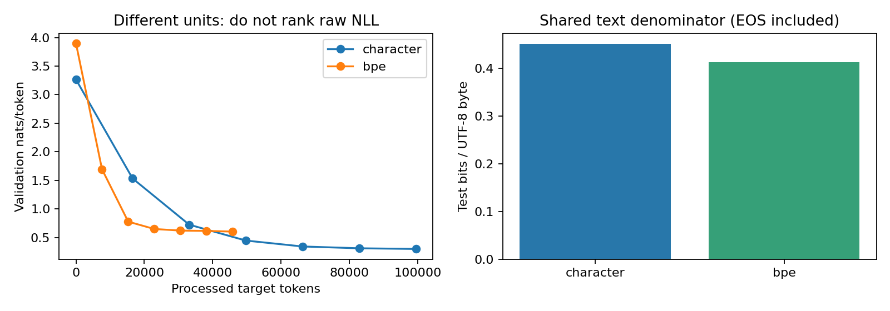

# 第101讲 实验：从文本到下一token

## 1. 问题与预注册预期

我们预期同一目标下训练后的验证损失低于随机初始化，但不预设字符模型与BPE谁胜出。要验证的是标签对齐、文档边界和评价口径，不是生成一段看似流畅的文本。

数据是原创模板组合：4个形容词、8个名词、3个动作，再组合第二个形容词和名词，排除完全相同的主宾实体描述，共2976篇。固定随机顺序后分为1800训练、400验证、776测试。分词器只使用1800篇训练文档。

<div class="key">验收须同时满足：训练/验证/测试全文互斥；测试字符无UNK；BPE编解码还原；x和y错一位；PAD不参与计数；未来token修改不改变更早输出；真正执行脚本、测试和笔记本。</div>

## 2. 安装与运行

在本课目录执行。Python建议3.11或更新，Node用于PDF数学公式，不参与训练。CPU无需GPU、账号或付费API。

```bash
python -m pip install -r requirements.txt
python experiment.py
python -m unittest -v test_experiment.py
python execute_notebook.py
```

重新生成PDF时安装Node依赖与Python依赖，再运行：

```bash
npm install
python build_pdf.py
```

生成PDF位于outputs/pdf；已审阅的发布PDF位于本课根目录。重新运行会覆盖本课数据、图与结果，因此修改实验前先另存自己的结果。

## 3. 逐token手算再看代码

打开outputs/results.json的alignment字段，把input与label按索引并排抄下。第一行input应是BOS；最后一行label应是EOS。对任意相邻位置，label[t]应等于input[t+1]。

在lm_common.py中找到batch函数。用长度不同的两篇句子构造批量，数非零标签个数，验证它等于两篇编码长度之和减2。试着在纸上说明为什么分母不能是整个矩阵的元素数。

练习A：若s=[BOS,a,b,EOS]，给出x、y以及有效目标数。练习B：把PAD也计入损失会偏向哪类批次？先写预测，再查看answers.md。

## 4. 训练分词器

Tokenizer(docs,24)逐轮统计相邻符号并合并。读data/tokenizer.json的前五条规则，追踪它们如何改变一个句子。验证encode之后decode可恢复原文。尝试含有训练字符表之外符号的字符串，解释为什么教学版UNK不能恢复原符号。

练习C：增加到48次合并，哪些量会变化？至少记录词表大小、平均序列长度、模型参数数、处理目标数和BPB。只改变合并数并不保证其它预算相同，不要把结果表述成完全控制的分词因果实验。

## 5. 训练模型与检查因果性

脚本使用单层GRU，宽度24，Adam学习率0.01，梯度范数裁剪为1，批量24，120步，种子7。两个分词配置都完成真实CPU训练。评估使用model.eval和no_grad，loss忽略PAD。

修改最后一个输入token，观察前面位置logits的最大差值。在当前确定性的单向实现中应为0。若替换成双向GRU而仍声称因果预测，这个检查会揭露未来依赖。不要在现有已验收结果上偷偷改模型；复制目录开展扩展。

## 6. 重算指标

从结果读取test.nll_sum和test.target_tokens，自己计算nll与exp(nll)。再读取data/test.jsonl，把原始text转UTF-8后累加字节数，重算BPB。不要平均每批PPL：指数是非线性的，应先累加NLL及目标数，再指数化。



练习D：为什么左图较低不能证明分词更好？练习E：如果测试文本内容相同但一份评价不计EOS，BPB是否已经严格可比？练习F：当前测试是否代表真实新闻、中文或长篇文档？给出证据和缺少的证据。

## 7. 提交物与故障排查

提交一页说明：输入标签例子、两种评价单位、实验参数、实际结果、至少两条不能推出的结论。附脚本、已执行笔记本、results.json和测试日志。

若出现零目标除法错误，先检查分区是否为空；若损失不降，检查是否把PAD算进分母、标签是否错位、学习率是否过大；若结果与发布版略有浮点差异，报告PyTorch版本和CPU环境。不能用手工填写输出替代重跑。
