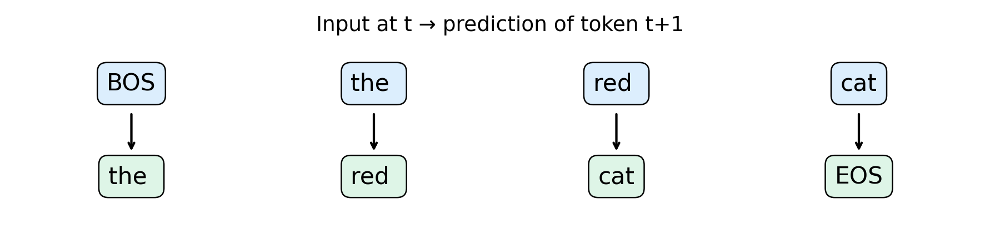

# 第101讲 分词与语言学习目标

从一句文字到一串监督信号：分词、标签右移与困惑度的单位。

直接先修：20、23、43、50、96、100。建议学习时间：讲义60分钟，实验60分钟。

本讲目标：能手工写出一条句子的输入与标签，解释为什么不能给因果模型看未来；能从总负对数似然重新算出困惑度，并知道哪些模型之间不能直接比较这个数字。

## 1. 模型从来没有直接看到“文字”

计算机中的文本首先是编码后的符号。模型接收的是整数序列；整数索引词向量，再交给序列模型。这里有三个不同对象：原始文本、token符号、token编号。编号27并不比编号3“语义更大”，它只是词表里的地址。改变编号排列并同步改变嵌入表，不会改变任务。

例如“the red cat.”可以按字符切成12个字符，也可以把“the ”作为一个token。两者都表示相同文字，却要求模型回答不同的问题：字符模型要预测下一个字母，子词模型可能一次预测一个词的一部分。词表越大，一步的分类空间通常越大，但同一段文字需要的步数可能越少。不能只说“序列更短所以一定更好”，因为输出层、长尾词频和训练样本量也随之改变。

本实验使用原创英文模板短句，是为了把规律和错误看清楚，不表示自然语言只有模板。所有数据由程序生成，先按完整文档划分，再训练分词器与模型。中文、空格、标点和emoji都可能形成不同切分，真实系统还必须说明Unicode归一化、字节回退等规则。

## 2. 从字符到BPE：为什么合并频繁邻居

字词表会遇到未登录词：训练没有见过的词不一定没有意义。“smallness”可能能由更小片段组合。字符模型没有英语单词级未知词问题，却要走更多预测步。子词把两者折中。

本课实现可检查的简化BPE：以训练文档的字符为初始符号，统计相邻符号对，选择出现次数最多的一对合并，更新序列，重复24次。频数相同按字典序决定，避免结果依赖字典插入顺序。编码新文档时按学到的顺序应用合并规则，不能重新统计测试集频率。

第一次合并后，统计对象已经改变。因此训练BPE不是一次性挑选24个原始字符对，而是24次顺序决策。我们的实现允许跨空格合并，也没有生产级字节回退；这是教学算法的边界。新字符会变成UNK，且无法无损还原。实验语料的测试字符全部被训练字符覆盖，测试另外检查这一条件。

先用全量数据训练词表，再声称“模型没看测试文本”仍然存在信息泄漏。分词规则、归一化参数、去重阈值、词频筛选都属于拟合过程，应当把训练边界写清楚。

## 3. 因果目标：为什么标签要向前错一位

给一篇文档加上起始BOS和结束EOS，得到序列。概率链式法则把整个序列的联合概率拆成条件概率：

$$p(x_1,\ldots,x_T)=\prod_{t=1}^{T}p(x_t\mid x_0,\ldots,x_{t-1}),\qquad x_0=\mathrm{BOS}.$$

对数把乘积变成求和，负号把最大化概率变成最小化损失：

$$\mathcal L=-\frac{1}{M}\sum_{d}\sum_{t=1}^{T_d}\log p_\theta(x_{d,t}\mid x_{d,<t}),\qquad M=\sum_d T_d.$$

这里的M是实际参与评分的目标token数，包括EOS、不包括BOS和补齐PAD。不同文档有不同长度，平均每篇的平均损失会让短文档和长文档权重相同；本课使用逐token总和再除总数，长文档贡献更多目标事件。

输入为[BOS, the, red, cat]，标签为[the, red, cat, EOS]。同一位置的输出必须预测输入之后的符号。若误把标签设成输入本身，模型可以学到复制当前符号，损失很好看，却没有学下一步预测。若输入多走一步而标签不变，则模型看到了答案，这是更隐蔽的泄漏。

代码里对同一个完整编码s取s[:-1]和s[1:]。不是把所有词随机移动，也不是把文档顺序打乱。PAD只为拼出矩形张量，不能作为大量容易预测的监督事件。忽略PAD损失不等于可以忽略注意力PAD掩码：若使用双向注意力，还必须阻止真实位置读取padding内容。本课GRU沿时间单向运行，右侧padding不会影响更早的有效位置。

## 4. Teacher forcing究竟强制了什么

训练时输入真实历史token，这叫teacher forcing。它没有把当前目标提前交给模型，而是把之前真实发生过的内容交给模型。这样每个位置都有稳定的训练条件。生成时，模型只能把自己刚生成的token放回输入，错误可能改变之后的上下文，这解释了训练损失和长文本生成质量之间的距离。

GRU在时间上递推隐藏状态。它不是Transformer，但只依赖过去的结构足够演示因果学习目标。目标函数与架构是两件事：Transformer可以做因果模型，也可以做双向掩码模型；GRU也可以预测下一个符号。本课不把这个小模型称为大型语言模型。

一个可操作的因果检查是：修改输入最后一个token，前面位置的logits应该保持不变。实验记录这一最大差值。检查通过证明实现没有这类未来依赖，不证明训练数据一定干净，也不覆盖所有潜在泄漏。

## 5. 掩码语言目标与因果目标的区别

掩码语言模型选择位置集合S，把这些位置的原始符号隐藏或替换，然后预测它们：

$$\mathcal L_{\mathrm{mask}}=-\frac{1}{|S|}\sum_{t\in S}\log p_\theta(x_t\mid \widetilde{x}).$$

符号x的波浪版本表示经过破坏的输入，可以包含被预测位置两边的上下文。比如“the [MASK] cat”允许看到后面的cat。它适合学习双向表示，但这些条件概率不能直接照搬成从左到右的链式联合概率。掩码比例、替换策略和评分位置都会改变评价口径。

同一批文本可以支持不同目标；任务定义包含“模型允许看到什么”和“在哪些位置评分”。本实验真正训练的是因果目标，并不声称同时训练了BERT或复现其结果。

## 6. 困惑度为什么需要单位

困惑度是平均负对数似然的指数：

$$\mathrm{PPL}=\exp(\mathcal L).$$

若每个目标位置都给正确符号四分之一概率，则损失为自然对数4，困惑度为4。这是一种平均不确定性的表达，不等于错误率，也不表示模型每次固定从4个候选里选择。模型可以一直把正确token排第一，却分配低概率，因此准确率高而困惑度仍高。

字符与BPE的token单位不同，直接比较PPL就像把每米成本和每公里成本排大小。实验同时报告总负对数似然除以原始UTF-8字节数，再换成以2为底的单位：

$$\mathrm{BPB}=\frac{\sum\mathrm{NLL}}{\ln 2\;\times\;\text{原始UTF-8字节数}}.$$

分子含EOS事件而分母不添加特殊符号字节，因此这是本课明确约定的文档级编码评分。共用文本、边界、EOS和UNK规则才能比较；该指标不能自动修复不同训练预算、不相同模型容量等混杂。我们的两模型宽度相同，但词表不同导致参数数不同；步数相同，但处理token数不同。结果是两个教学配置的比较，不是“BPE必然优于字符”的因果结论。

## 7. 阅读真实结果

打开outputs/results.json，从models读取词表大小、参数数、处理token数、训练和验证损失及测试指标。左图下降表明相应目标变得更可预测；右图反映同一测试文本在各自模型下的评分。若只报告最低验证点而不说明如何选点，会把调参收益混入最终评价。本课固定120步，再打开测试集。

文档完全不重叠还不等于语义独立：训练和测试共享模板、词表、句法规则，因此这是同分布组合泛化。不能据此断言可写长篇中文、回答事实问题或抵抗域外分布。

## 8. 课后自检与下一讲

闭上讲义，写出BOS、a、b、EOS对应的输入和标签；再解释PAD为什么不进入分母。能说清这些，比记住某个困惑度更重要。第102讲固定分词与评价单位，分别改变数据量和参数量，检查“更大”究竟花了什么预算。

参考：Sennrich等关于子词单元的原始论文，https://arxiv.org/abs/1508.07909 。该论文说明了子词处理开放词表问题的动机；本课的简化BPE与GRU结果为独立教学实验，不是论文复现。
