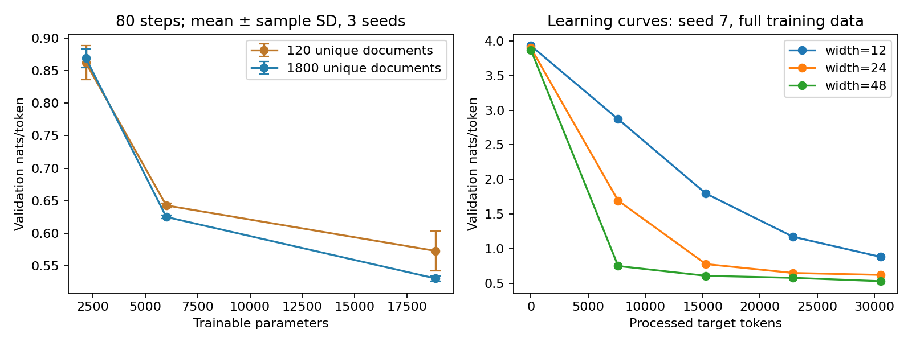

# 第102讲 答案与规模实验解读

## 1. A：参数数

对词表大小V、宽度h，嵌入Vh，GRU权重6h平方、偏置6h，输出hV+V。总和为6h平方+2Vh+6h+V。具体V见data/tokenizer.json的symbols长度，用这个值核对outputs/results.json里的parameters。词表特殊符号也属于输出维度，不应从V里偷偷减掉。

## 2. B：数据重复暴露

processed_target_tokens记录训练过程中真的参与loss的非PAD标签数；unique_train_target_tokens只数训练池每篇一次。同样80步、24篇批量，小数据组从120篇有放回抽样，大数据组从1800篇抽样，所以小数据重复暴露更强。两者的比值是整体暴露量，不保证每篇恰好访问该次数。

## 3. C：复制不创造独立信息

复制十遍会增加文件行数，但唯一文档数仍是1800。若训练程序把所有行都当数据并遍历，累计暴露可能增加；如果固定有放回抽样步数，也可能只是改变抽样实现而不增加总预算。精确哈希对改标点的文档无法判为重复，需要归一化或近重复策略；任何策略也要考虑误删真正不同内容的风险。

## 4. D：实际运行结论

18次训练完成。三种子平均验证NLL：宽度12时，120篇为0.8620、1800篇为0.8690；宽度24时为0.6429与0.6252；宽度48时为0.5730与0.5306。验证选择宽度48、1800篇；固定种子7对应的独立测试NLL为0.5374，PPL为1.7115。

这个结果不是处处“数据越多越好”：宽度12的小数据组平均损失略低。有限更新次数下，优化速度、模板重复和子集构成都会起作用。差异必须结合三个种子的原始值与标准差阅读，不应仅凭0.007左右的差别宣告稳定优势。

最终测试是选定配置的种子7模型，而不是18次测试里挑最小值。种子7用于重建固定设置，不是根据测试挑选种子。这一点将模型选择与最终报告分离，但一个测试随机种子仍不足以描述最终测试不确定性。

## 5. E：等计算方案

粗略代理C=6ND。如果大模型参数是小模型的r倍，则相同代理预算下，大模型可处理的目标token约为小模型的1/r。实际批量文档长度不同，不能只按步数比例硬除；应边训练边累计有效token，达到目标附近停止，并报告最后一批带来的超额。

还应提前固定学习率调度相对于token还是步数变化，否则缩短步数同时改变了优化节奏。等代理不等墙钟，GRU上的6ND只是粗略记账。当前发布实验没有执行等计算方案，所以这部分是实验设计答案，不是新结果。

## 6. F：三点拟合不能保证外推

本次大数据组三尺度log损失直线斜率约为−0.2260。它只描述这三个局部设置，不是普适指数。参数再增100倍可能失效，因为：训练步数不足、学习率不适用、数据覆盖饱和、不可约损失下限非零、架构与计算项改变、评估分布变化。任选四项并说明作用路径即可。

相同三个点既用来拟合又用来展示好看程度，没有独立外推检验。检查点数量再多也不能替代新的参数尺度，因为同一训练轨迹上的点相关且N不变。

## 7. G：识别不可约项的困难

若同时拟合E、A和指数，三个数据点恰好对应三个未知量，几乎没有冗余去检验模型错设。测量噪声可能引起参数巨大变化；E与指数可以互相补偿。需要更多尺度点、噪声建模、残差检查以及未参与拟合的尺度验证。不能把E固定为0的简化结果偷偷解释为识别了真实下限。

## 8. 什么才算合格研究结论

报告“固定更新次数、固定分词的模板任务中，更宽设置总体验证损失较低，数据量效果依赖宽度；实验不控制等计算，不能证明大型模型规模律”。再附参数、处理token、数据规模、随机种子、原始损失与方差。

满分10分：参数和预算核对2分；数据边界及污染2分；均值/标准差与测试选择2分；拟合假设和外推边界2分；提出可执行且明确尚未运行的等预算扩展2分。
