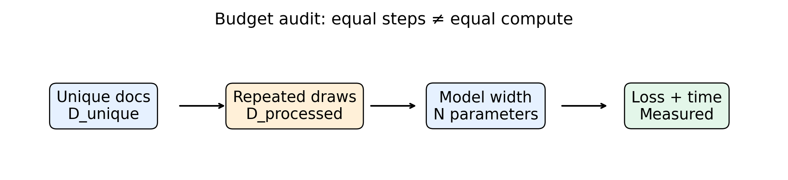

# 第102讲 语言模型训练与规模

从“多训练一点”到可检验的预算实验：参数、数据、计算和外推边界。

直接先修：39、53、88、90、100、101。建议学习时间：讲义60分钟，实验75分钟。

本讲目标：区分独立数据量与累计处理token，设计受控的参数×数据实验；能解释同样训练步数为什么不是同样计算成本，并拒绝把三点拟合包装成大模型规模定律。

## 1. 为什么规模问题首先是记账问题

“模型A用了更多数据”可能有三种意思：更多独立文档、同一文档重复更多轮，或者把文本切得更碎所以token更多。三者对学习的作用不同。增加新文档可能增加覆盖范围；重复旧文档可以优化参数，却不会创造新信息；改变切分会改变训练目标的单位。因此，先固定分词器、数据分割和损失口径，再谈规模。

本实验沿用第101讲的原创短句与简化BPE，训练词表只见训练分区。三种隐藏宽度12、24、48和两种独立训练文档数120、1800组合成六个设置，每个设置运行三个随机种子。模型是单层GRU，CPU可执行，目的在于观察控制变量与预算记录，不是用小模型声称重现大型Transformer的能力。

## 2. 三种预算要分别写出来

用N表示可训练参数数，独立数据量记为D_unique，累计处理目标token记为D_processed。后者包括重复抽样，也包括EOS，不包括PAD与BOS。本实验每步有24篇有放回抽样文档，训练80步。文档长短和BPE分段不同，所以目标token总数通过实际标签计数，不能用“步数×批量×最大长度”冒充。

若每步平均有m个有效目标，则S步大约处理Sm个目标。若独立训练集有U个目标，D_processed/U可作为重复暴露的近似指标；有放回抽样不等于每篇刚好重复同样次数。我们记录精确处理总量和唯一训练集总量，让读者自己检查。

“同样80步”控制了优化更新次数，并未控制总计算量。大模型一次更新更贵；不同句长也改变一次更新的成本。报告需要明确是在比较等步数、等token、等估计FLOPs还是等墙钟时间。

## 3. 参数数为什么随宽度快速增长

嵌入层需要词表大小V乘宽度h个参数；输出层大约也需要Vh个权重。GRU有三个门，每个门包含输入映射、隐藏状态映射和偏置，因此本实现总参数数为：

$$N=Vh+3h^2+3h^2+6h+hV+V=6h^2+2Vh+6h+V.$$

这里的六组偏置来自PyTorch GRU对输入和隐藏各自保存偏置。我们没有绑定嵌入层和输出层权重。公式与sum(p.numel())互相核对，防止配置标签与实际模型不一致。

当h翻倍时，h平方项变为四倍，参数未必刚好翻倍。更宽可能提供更多表达能力，也提高每步计算和优化难度。如果模型还没训练够，较大模型表现差并不证明容量无用；如果测试集过于简单，较小模型饱和也不证明大模型普遍没价值。

## 4. 计算量估计能做什么，不能做什么

稠密模型训练常用数量级代理：

$$C\approx 6ND_{\mathrm{processed}}.$$

直觉是一次权重矩阵乘法有乘与加，反向传播又要计算输入梯度和参数梯度，于是得到常数级倍数。它省略具体算子、注意力长度项、嵌入查表、GRU非线性与优化器成本。本课保存名为compute_proxy_6ND的代理值，明确不是测量得到的FLOPs。

墙钟时间还受CPU型号、线程数、缓存、框架开销和并行竞争影响。我们固定torch为单线程，记录实际训练耗时；同一脚本在不同机器上的秒数不应硬性相等。学习曲线含验证开销，train_seconds包含这些评估，所以它也不是纯训练内核的计时。

若想回答“固定计算预算怎么分配”，应该给每种参数量分配不同步数，使累计代理接近同一目标，并记录舍入误差。当前实验回答的是固定更新次数下，宽度和训练池大小怎样关联于验证损失。不能在结论里悄悄把问题换成等计算最优。

## 5. 一个完整的受控实验

控制变量包括：同一tokenizer、同一验证集、同一学习率0.01、同一优化器Adam、同一批量24、同一步数80、同一种梯度裁剪和单线程CPU。改变的变量只有隐藏宽度与训练池大小；每组用7、19、31三个种子重复。

较小训练集是大训练集前120篇，是嵌套子集，因此数据量实验不同时引入完全不同来源。但这仍可能混入子集的偶然构成；三个种子改变初始化与抽样，不改变这120篇的身份。若要估计数据子集选择的不确定性，还应独立抽取多个子集。本课的误差条不能声称覆盖全部数据不确定性。

训练词表来自完整训练分区，即使120篇配置也共用这个词表。因此“小数据”在本课严格指语言模型更新的文档池，而不是端到端只接触120篇的系统。固定词表使输出空间可比，但必须披露这项预处理信息。

对每组记录训练和验证损失。训练低、验证高提示过拟合或分布差异；两者都高可能是容量、优化或者任务本身难度。单看训练损失随参数下降不能代表泛化改善。测试集留到使用验证均值选出配置后才打开；最终测试报告固定种子7的选定模型，不把测试结果用于再次选择。该配置额外复训一次，因此实际执行18次网格训练加1次复训；每条6ND只核算一条运行，不包含全项目选型与复训总成本。

## 6. 怎样读曲线与误差条

左图每个点不是一次幸运运行。样本标准差描述三个运行值的分散程度，不是95%置信区间，也不代表真实分布的精确范围。三个样本不足以判断细小差异，因此应同时查看原始runs列表。

右图横轴是累计有效目标token。随着训练推进，损失下降速度可能减慢，这是边际收益变小的直接观察。不要把曲线末尾仍在下降的模型称为“收敛”。同一条曲线的多个检查点高度相关，不能当作多个独立实验来人为增加统计样本量。

当小数据配置表现意外更好时，先检查抽样暴露次数：同样80步，它会反复看同一批句子，更容易优化。在共享模板的验证集上，快速掌握模板可能暂时获益。这不是“数据越少越好”，而是数据覆盖与优化速度在有限预算下共同起作用。

## 7. 从经验拟合到规模律：差在哪里

一个常见经验形式把损失拆为不可约项和参数、数据项：

$$L(N,D)=E+A N^{-\alpha}+B D^{-\beta}.$$

E是该分布与度量下的剩余损失尺度，A、B、指数都需从适当数据拟合。这不是由概率链式法则推出的定理。改变分布、训练方法、预算区间甚至分词方式，都可能改变拟合关系。

为了让拟合过程透明，脚本只对1800篇设置的三个参数规模，把log损失对log参数做直线描述。这里强行假定E为0，既未识别不可约项，也没有留出规模点检验外推。输出中的slope只是局部曲线斜率，不应称为大型语言模型的普适指数。

只要拿三个点就能画出一条漂亮线，外观并不等于可信。要研究外推，需要更多对数间隔的规模、足够训练的每个配置、统一的成本口径、留出更大规模做预测检验，并观察残差和不确定性。若改变规模同时改变数据质量或评估基准，拟合可能只是混杂因素的影子。

## 8. 去重与污染为什么影响规模结论

一百篇不同ID的文档可能复制了同一文本。本课按原始内容生成哈希ID，测试三分区全文集合互不相交；这只能查精确重复，不能发现近重复和改写。真实语料还需规范化去重、段落近重复检测、来源追踪和时间边界。不能因为精确哈希没撞就宣布不存在污染。

如果测试题或它的解答进入训练集，增加数据可能同时增加泄漏，测试分数随规模上涨就不能全部归因于泛化能力。文档切块应在划分之后执行；先切重叠窗口再随机分会让相邻内容跨边界。

## 9. 用一段话写出合格结论

合格结论应包含任务、对比、预算、观察和边界。例如：“在相同BPE、模板分布和80次更新下，比较三种宽度与两种训练池，报告三种子验证均值和标准差；实际参数和token见结果文件。该结果未进行等计算优化，也未证明自然文本或大模型外推。”根据实际结果补充哪个设置最低，不预设更大一定更好。

参考：Kaplan等，Scaling Laws for Neural Language Models，https://arxiv.org/abs/2001.08361 ；Hoffmann等，Training Compute-Optimal Large Language Models，https://arxiv.org/abs/2203.15556 。两项研究说明经验规模趋势与计算分配的研究问题；本课没有复现其模型、数据或指数。
